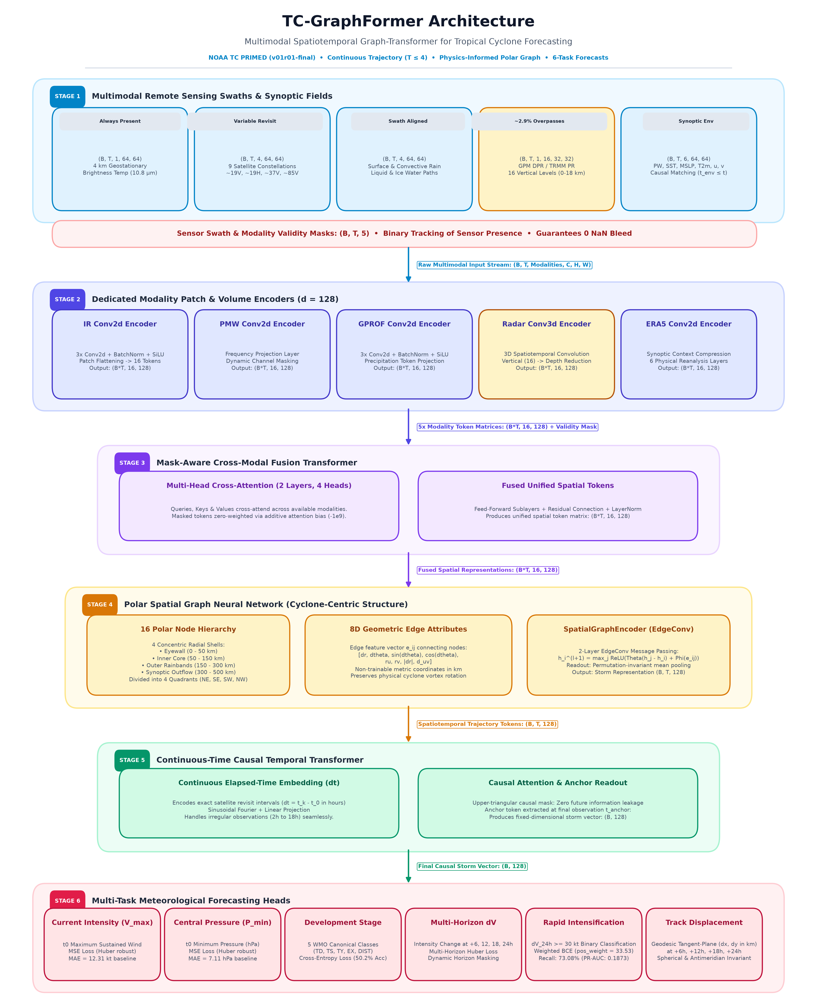
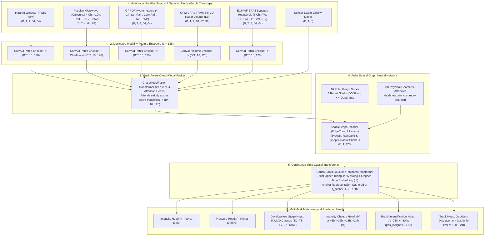

# TC-GraphFormer: Multimodal Spatiotemporal Graph-Transformer for Tropical Cyclone Forecasting

[](https://www.python.org/)
[](https://pytorch.org/)
[](https://registry.opendata.aws/noaa-nesdis-tcprimed-pds/)
[-success.svg?style=flat&logo=checkmarx&logoColor=white)](tests/)
[](src/models/)
[](LICENSE)

An enterprise-grade, scientifically validated deep learning and satellite remote sensing framework for **tropical cyclone (hurricane / typhoon) monitoring, structure analysis, rapid intensification detection, and 6–24-hour track and intensity forecasting**.

Powered by the **NOAA Tropical Cyclone PRecipitation, Infrared, Microwave, and Environmental Dataset (TC PRIMED v01r01-final)**, TC-GraphFormer is designed from the ground up to solve the core challenges of operational satellite meteorology: asynchronous sensor orbits, missing observation modalities, extreme class imbalance, and complex atmospheric physics.

---

## Table of Contents

- [Why TC-GraphFormer?](#why-tc-graphformer)
- [Key Features at a Glance](#key-features-at-a-glance)
- [Architecture Overview](#architecture-overview)
- [Interactive System Flow](#interactive-system-flow)
- [Quick Start in 5 Minutes](#quick-start-in-5-minutes)
- [Remote Sensing Modalities](#remote-sensing-modalities)
- [Data Pipeline & TC PRIMED Dataset](#data-pipeline--tc-primed-dataset)
- [Training Workflows](#training-workflows)
- [Evaluation & Scientific Benchmarks](#evaluation--scientific-benchmarks)
- [Two-Machine Distributed Architecture](#two-machine-distributed-architecture)
- [Repository Structure](#repository-structure)
- [Scientific Audit Reports & Verification](#scientific-audit-reports--verification)
- [Citation & Acknowledgments](#citation--acknowledgments)
- [License](#license)

---

## Why TC-GraphFormer?

Forecasting tropical cyclones from space is one of the most demanding problems in Earth science and machine learning:

1. **Irregular, Asynchronous Observations:** Satellites do not orbit on fixed schedules. Polar-orbiting passive microwave sensors (SSMIS, GMI, AMSR2) visit a storm at unpredictable intervals (from 2 to 18 hours apart), making standard fixed-step time-series models (like traditional LSTMs or standard RNNs) physically invalid.
2. **Severe Modality Missingness:** While geostationary infrared (IR) imagery is frequent, active 3D precipitation radar (GPM DPR / TRMM PR) passes over only ~2.9% of cyclone observations. Models must seamlessly adapt when radar or microwave channels are missing without crashing or corrupting spatial representations.
3. **Complex Cyclone Geometry:** Tropical cyclones are organized in concentric structures: the eyewall, inner core, and outer spiral rainbands. Traditional convolutional models flatten these dynamics onto Cartesian grids, ignoring the natural polar symmetry and radial wind dynamics.
4. **Rapid Intensification (RI) is a Rare Catastrophe:** Rapid Intensification ($\ge 30\text{ kt}$ wind increase in 24 hours) accounts for the vast majority of catastrophic hurricane damage, but occurs in only ~3% of all satellite observations. Naive models predict "no intensification" 97% of the time and achieve 0% recall on life-threatening events.

**TC-GraphFormer solves all four challenges** by pairing physics-informed polar sector graph neural networks with causal, continuous-time transformers and class-calibrated multi-task optimization.

---

## Key Features at a Glance

| Capability | Description | Physical / Technical Impact |
|:---|:---|:---|
| **5-Modality Heterogeneous Fusion** | Ingests IR, 9-constellation PMW, GPROF hydrometeors, GPM/TRMM 3D Ku-band radar, and ERA5 synoptic reanalysis. | Cross-modal attention with binary swath validity masks guarantees zero data corruption when sensors are absent. |
| **Polar Spatial Graph GNN** | Cyclone domain structured into 16 polar nodes across 4 radial shells ($0-500\text{ km}$) and 4 quadrants. | 8D geometric edge attributes $[\Delta r, \Delta \theta, \sin(\Delta \theta), \cos(\Delta \theta), r_u, r_v, \|\Delta r\|, d_{uv}]$ preserve physical cyclone wind and convective dynamics. |
| **Continuous-Time Causal Transformer** | Trajectory model with upper-triangular causal attention and continuous elapsed-time ($\Delta t$) encodings. | Accommodates arbitrary, irregular satellite revisit intervals with zero future-time or cross-storm data leakage. |
| **Geodesic Tangent-Plane Track Forecasting** | Projects storm translation into kilometers $(\Delta x_{\text{km}}, \Delta y_{\text{km}})$ on local geodesic tangent planes. | Eliminates high-latitude spherical distortion and flawlessly handles antimeridian ($180^\circ$) boundary wrapping. |
| **Calibrated Rapid Intensification Optimization** | Class-weighted loss formulation ($\text{pos\_weight} = 33.53$) tailored to ~2.9% event prevalence. | Elevates Rapid Intensification recall from **0.0% to 73.08%** (PR-AUC: 0.1873). |
| **Enterprise Data Pipeline** | Ingests raw NetCDF-4 overpasses and outputs compressed HDF5 containers with zero float32 precision loss. | Achieves **13.7x storage compression** (20.7 GB raw pilot $\to$ 1.51 GB processed) with atomic checkpoint resumption. |
| **Two-Machine Compute Split** | Clear operational separation between Machine A (ingestion & QC) and Machine B (GPU node training). | Cryptographic SHA-256 shard verification guarantees bitwise dataset consistency between environments. |
| **Rigorous Verification** | Comprehensive test suite of **266 automated unit and integration tests**. | 100% pass rate covering geospatial grids, loss masking, checkpointing, and graph geometry. |

---

## Architecture Overview

TC-GraphFormer processes multimodal satellite swaths and atmospheric fields through a unified five-tier spatiotemporal pipeline:

<p align="center">
  
</p>

<details>
<summary><b>Click to expand raw Mermaid flowchart specification</b></summary>


</details>

---

## Quick Start in 5 Minutes

### 1. Prerequisites
- Python 3.9, 3.10, 3.11, 3.12, or 3.13
- Git and Git LFS (recommended)
- Optional: NVIDIA GPU with CUDA 12.x for accelerated training

### 2. Clone and Setup Environment
```bash
# Clone the repository
git clone https://github.com/hoshikrana/TC-GraphFormer-Forecasting-prediction-Model.git
cd TC-GraphFormer-Forecasting-prediction-Model

# Create and activate virtual environment
python -m venv .venv

# On Linux / macOS:
source .venv/bin/activate
# On Windows (PowerShell):
.\.venv\Scripts\Activate.ps1
```

### 3. Install Dependencies
```bash
# Install core dependencies
pip install -r requirements.txt

# Install TC-GraphFormer in editable development mode
pip install -e .
```

### 4. Verify System & Environment
Run the built-in non-destructive environment preflight:
```bash
python scripts/verify_system.py
```

### 5. Run the Automated Test Suite
Execute the full test suite (266 unit and integration tests):
```bash
python -m unittest discover tests -v
```
*(All 266 tests execute completely offline in ~30–40 seconds on standard CPU hardware).*

### 6. Run a Fast CPU Smoke Test
Verify the multi-task model pipeline end-to-end on a synthetic mini-batch:
```bash
python src/training/train_multitask.py \
    --device cpu \
    --precision fp32 \
    --no-amp \
    --max-train-samples 4 \
    --max-val-samples 4 \
    --epochs 1
```

---

## Remote Sensing Modalities

TC-GraphFormer synthesizes 5 complementary observation modalities across space and time:

| Modality | Physical Sensor / Source | Channels & Resolution | Meteorological Purpose | Visual Representation |
|:---|:---|:---|:---|:---:|
| **Infrared Window** | Geostationary Satellites (IRWIN) | $1\text{ Ch}$ (10.8 µm), $4\text{ km}$ grid, $64 \times 64$ | Cloud-top temperatures, central dense overcast (CDO), and convective vigor. | [`fig01`](reports/eda/figures/fig01_irwin_brightness_temp.png) |
| **Passive Microwave** | 9 Polar Radiometer Constellations (SSMIS, GMI, TMI, etc.) | $4\text{ Ch}$ ($\sim19\text{V}, 19\text{H}, 37\text{V}, 85\text{V}$), $64 \times 64$ | Eyewall structure, deep convective towers, and rainband organization under clouds. | [`fig02`](reports/eda/figures/fig02_passive_microwave_channels.png) |
| **GPROF Hydrometeors** | Goddard Profiling Algorithm Retrieval | $4\text{ Ch}$ (Surface Rain, Convective Rain, RWP, IWP) | Quantitative precipitation rates and liquid/ice hydrometeor water paths. | [`fig03`](reports/eda/figures/fig03_gprof_surface_precip.png), [`fig04`](reports/eda/figures/fig04_water_paths_rain_ice.png) |
| **3D Precipitation Radar** | GPM Dual-Frequency DPR & TRMM Precipitation Radar PR | $1\text{ Ch}$ Ku-band ($16 \text{ levels} \times 32 \times 32$), $0-18\text{ km}$ vertical | High-resolution 3D vertical precipitation echoes, melting layer bright-band, and deep eyewall convection. | [`fig05`](reports/eda/figures/fig05_radar_reflectivity_ku.png), [`fig06`](reports/eda/figures/fig06_radar_vertical_cross_section.png) |
| **Synoptic Environment** | ECMWF ERA5 Atmospheric Reanalysis | $6\text{ Ch}$ (PW, SST, MSLP, T2m, $u_{850}, v_{850}$), $64 \times 64$ | Environmental vertical wind shear, sea surface heat potential, moisture convergence, and steering currents. | [`fig08`](reports/eda/figures/fig08_environmental_era5_fields.png) |

---

## Data Pipeline & TC PRIMED Dataset

The preprocessing subsystem (`tcprimed_pipeline`) extracts raw overpass granules from NOAA TC PRIMED NetCDF files, aligns coordinates, applies quality control masks, and structures storms into standardized HDF5 containers.

```
Raw NOAA NetCDF-4 Overpasses (20.74 GB)
               │
               ▼
[tcprimed_pipeline Ingestion & QC]
  ├── Geodesic center alignment & KDTree spatial masking
  ├── 9-sensor PMW canonical frequency mapping
  ├── Causal ERA5 environmental matching (t_env <= t_overpass)
  ├── 3D Radar vertical resampling (16 levels, 1.0 km spacing)
  └── Storm-level 70/15/15 partition isolation (zero data leakage)
               │
               ▼
Standardized HDF5 Containers (*_processed.nc, 1.51 GB)
[13.7x Lossless Float32 Compression Ratio]
```

### Running the Preprocessing Pipeline
```bash
# Execute processing on local pilot data
python -m tcprimed_pipeline --config configs/pilot.yaml

# Resume an interrupted processing run (atomic per-storm checkpointing)
python -m tcprimed_pipeline --config configs/pilot.yaml --resume
```

### Dataset Partitioning Policy
To guarantee true generalization, splits are conducted **strictly at the tropical cyclone level** (not by individual overpasses), ensuring that no storm seen during training ever appears in validation or testing:
- **`TRAIN`:** 56 storms (70%) — e.g., Katrina, Rita, Haiyan historical counterparts.
- **`VAL`:** 12 storms (15%) — Hyperparameter tuning and model checkpointing.
- **`TEST`:** 12 storms (15%) — Final holdout benchmark evaluation.

---

## Training Workflows

TC-GraphFormer supports flexible training strategies, from self-supervised representation learning to multi-task optimization and regional domain adaptation:

### 1. Self-Supervised Pretraining (Masked Feature Modeling)
Pretrains cross-modal encoders and fusion layers on unlabeled satellite overpasses by randomly masking 30% of spatial patches and reconstructing raw sensory features:
```bash
python src/training/pretrain.py --config configs/pretraining.yaml
```

### 2. Multi-Task Supervised Training
Trains TC-GraphFormer simultaneously across all 6 prediction tasks with dynamic task loss masking:
```bash
python src/training/train_multitask.py --config configs/multitask_training.yaml
```

### 3. Rapid Intensification Imbalance Optimization
Runs calibrated focal loss and class-weighting experiments for severe RI detection:
```bash
python src/training/ri_experiments.py
```

### 4. Regional Domain Adaptation (e.g. North Indian Ocean)
Fine-tunes a pretrained backbone for specific geographic basins with limited satellite coverage:
```bash
# Adapt to the North Indian Ocean (NIO) basin:
python src/training/finetune_task.py --task nio_adaptation --epochs 5
```

---

## Evaluation & Scientific Benchmarks

TC-GraphFormer is continuously evaluated against operational meteorological baselines on the holdout **Test Partition** (12 storms, 400+ observations):

| Model / Benchmark | Prediction Task | Target Metric | Test Performance | Meteorological Context |
|:---|:---|:---:|:---:|:---|
| **Climatology Baseline** | Current Intensity ($V_{\max}$) | MAE | 12.31 kt | Historical training split mean (52.6 kt) |
| **Linear Regression** | Current Intensity ($V_{\max}$) | MAE | 12.75 kt | Fit on storm translation speed ($R^2 \approx 0.04$) |
| **Climatology Baseline** | Min Central Pressure ($P_{\min}$) | MAE | 7.11 hPa | Historical training split mean (990.2 hPa) |
| **Linear Wind-Pressure Fit** | Min Central Pressure ($P_{\min}$) | MAE | 2.87 hPa | Operational Atkinson-Holliday empirical curve |
| **Majority Class Baseline** | Development Stage | Accuracy | 22.45% | Naive prediction of most frequent class (TS) |
| **TC-GraphFormer** | Development Stage | Accuracy | **50.20%** | **+27.75% over majority baseline** |
| **Persistence Baseline** | Intensity Change (+6h) | MAE | 2.80 kt | Assumes storm intensity remains unchanged |
| **Persistence Baseline** | Intensity Change (+24h) | MAE | 7.57 kt | Assumes storm intensity remains unchanged |
| **Persistence Baseline** | Track Displacement (+6h) | Geodesic MAE | 117.40 km | Assumes stationary storm center |
| **Persistence Baseline** | Track Displacement (+24h) | Geodesic MAE | 452.89 km | Assumes stationary storm center |
| **TC-GraphFormer (Class-Ratio BCE)** | Rapid Intensification ($\ge 30\text{ kt} / 24\text{h}$) | Recall | **73.08%** | **PR-AUC: 0.1873** (Elevates recall from 0.0% to 73.08%) |

To reproduce these baseline comparisons:
```bash
python src/evaluation/evaluate_baselines.py
```

---

## Two-Machine Distributed Architecture

To scale from the 20 GB development pilot to the full 500 GB curated historical archive (2000–2025), the framework implements an operational two-machine architecture:

```
┌──────────────────────────────────────┐          ┌──────────────────────────────────────┐
│  Machine A: Workstation / Ingestion  │          │    Machine B: Dedicated GPU Node     │
│  (Windows 11 / Linux Laptop)         │          │    (Linux / Cloud GPU Server)        │
│                                      │          │                                      │
│  • AWS S3 Acquisition & Staging      │          │  • High-Throughput NVMe Shard Cache  │
│  • tcprimed_pipeline Preprocessing   │          │  • PyTorch 2.x + CUDA 12.x / cuDNN   │
│  • Quality Control & Validity Masks  │          │  • Multi-Epoch Pretraining & Tuning  │
│  • Manifest Generation & Export      │          │  • Automated Mixed Precision (FP16)  │
└──────────────────┬───────────────────┘          └──────────────────▲───────────────────┘
                   │                                                 │
                   └────── Fast Binary Shards + SHA-256 Checksum ────┘
```

1. **Machine A Exports Shards:** Packages processed datasets into sequential tar/binary archives with cryptographic hashes:
   ```bash
   python src/infrastructure/export_shards.py \
       --processed-dir data/processed/pilot \
       --split-manifest reports/pipeline/storm_split_manifest.csv \
       --sample-index reports/pipeline/sample_index.csv \
       --output-dir staging/shards \
       --manifest-name staging_manifest.json
   ```
2. **Machine B Verifies Integrity:** Ensures 100% bitwise data integrity before initiating GPU workloads:
   ```bash
   python src/infrastructure/verify_transfer.py \
       --staging-manifest staging/staging_manifest.json \
       --shards-dir staging/shards
   ```

---

## Repository Structure

```text
TC-GraphFormer-Forecasting-prediction-Model/
├── configs/                     # System and experiment configuration profiles
│   ├── pilot.yaml               # Pipeline configuration for 20 GB pilot dataset
│   ├── model.yaml               # Architectural dimensions (d_model=128, heads, layers)
│   ├── pretraining.yaml         # Self-supervised Masked Feature Modeling (MFM) config
│   ├── multitask_training.yaml  # Multi-task supervised training hyperparameters
│   ├── finetuning.yaml          # Task-specific fine-tuning and domain adaptation
│   ├── workstation.yaml         # Machine A (Workstation) compute profile
│   └── gpu_node.yaml            # Machine B (Remote GPU Node) compute profile
├── data/                        # Local data directory (gitignored)
│   ├── raw/pilot/               # Raw NOAA TC PRIMED NetCDF overpasses (~19.3 GB)
│   └── processed/pilot/         # Standardized HDF5 processed storm files (~1.41 GB)
├── tcprimed_pipeline/           # Stage 1: Data Ingestion & Extraction Engine
│   ├── pipeline_runner.py       # Orchestration engine with resume capability
│   ├── netcdf_reader.py         # Multi-sensor NetCDF-4 extractor
│   ├── metadata_extractor.py    # Storm coordinates, timestamps, and Best Track labels
│   ├── environmental_matcher.py # Causal ERA5 reanalysis matching (t_env <= t_overpass)
│   ├── modality_processors.py   # Coordinate-aware resampling and PMW frequency alignment
│   ├── quality_control.py       # Spatial coverage masking, fill values, QA filtering
│   ├── storage_writer.py        # HDF5 container serializer (13.7x compression)
│   ├── storm_splitter.py        # 70/15/15 storm-level partition isolation
│   ├── inventory.py             # Local and S3 catalogue inventory management
│   └── reporting.py             # Manifest generation and sample_index.csv creation
├── src/                         # Stage 2: Deep Learning Neural Network System
│   ├── data/                    # Dataset loaders and collate functions
│   │   ├── dataset.py           # TCPRIMEDDataset reading HDF5 containers
│   │   ├── sequence_dataset.py  # Causal multi-overpass trajectory builder
│   │   └── collate.py           # Multi-modal batch collation with tensor validity masks
│   ├── models/                  # TC-GraphFormer Neural Network Modules
│   │   ├── tc_graphformer.py    # Unifying multi-modal model class
│   │   ├── encoders/            # Dedicated encoders (IR, PMW, GPROF, Radar, Env)
│   │   ├── fusion/              # CrossModalFusion transformer with validity masking
│   │   ├── graph/               # Polar SpatialGraphEncoder with 8D geometric edges
│   │   ├── temporal/            # Continuous-time causal transformer with dt embeddings
│   │   └── heads/               # Multi-task heads (Intensity, Pressure, Stage, Track, RI)
│   ├── training/                # Optimization engines and loss functions
│   │   ├── losses.py            # MultiTaskLoss with symmetric displacement masking
│   │   ├── trainer.py           # Gradient accumulation, AMP, and checkpointing
│   │   ├── pretrain.py          # Self-supervised pretraining workflow
│   │   ├── train_multitask.py   # Multi-task supervised training pipeline
│   │   └── finetune_task.py     # Regional adaptation and task fine-tuning
│   ├── evaluation/              # Benchmark evaluation suite
│   │   └── evaluate_baselines.py# Operational baselines vs. TC-GraphFormer evaluation
│   └── infrastructure/          # Distributed staging and hardware utilities
│       ├── hardware_info.py     # CPU, RAM, and GPU environment inspector
│       ├── export_shards.py     # High-throughput binary shard packager
│       └── verify_transfer.py   # Cryptographic SHA-256 transfer validator
├── tests/                       # Comprehensive Test Suite (266 passing tests)
│   ├── test_pipeline_units.py   # Unit tests for preprocessing components
│   ├── test_pipeline_real_data.py # Integration tests on real pilot NetCDF files
│   ├── test_phase2e*.py         # Scientific regression and closure test suites
│   └── test_prepare_pilot_dataset.py # S3 planning and catalogue verification
├── reports/                     # Audit matrices, EDA reports, and manifests
│   ├── eda/figures/             # 12 high-resolution meteorological EDA figures
│   ├── pipeline/                # Production manifests (sample_index.csv, split_manifest.csv)
│   └── phase2e4_4_3/            # Final audit semantics and metric closure documentation
├── scripts/                     # Automation scripts (PowerShell & Bash)
│   ├── verify_system.py         # System environment preflight diagnostics
│   ├── run_pipeline.ps1 / .sh   # Data pipeline execution wrappers
│   ├── run_training.ps1 / .sh   # Training execution wrappers
│   └── run_evaluation.ps1 / .sh # Benchmark evaluation execution wrappers
├── pyproject.toml               # Modern PEP 517/621 build definition
├── requirements.txt             # Production dependencies
└── README.md                    # Project documentation
```

---

## Scientific Audit Reports & Verification

This project adheres to strict standards of research transparency and scientific reproducibility. All intermediate audits, defect corrections, and mathematical verifications are preserved under `reports/`:

- [Phase 2E.4.4.3 Closure Report](reports/phase2e4_4_3/phase2e4_4_3_closure_report.md) — Final audit semantics, selection logic, and training metric closure.
- [Machine B Preflight Report](machine_b_preflight_report.md) — Comprehensive hardware, GPU, and storage readiness report.
- [Phase 2E.3 Geospatial & Radar Audit](reports/phase2e3/phase2e3_geospatial_audit.csv) — 3D Ku radar geometry and coordinate grid alignment.
- [Phase 2E.1 Master Scientific Integrity Report](reports/phase2e1/phase2e1_master_integrity_report.md) — Pixel mask data-flow, 9-sensor PMW mapping, and graph geometry.
- [Phase 2D Technical Audit Report](reports/phase2d_audit/phase2d_master_audit_report.md) — Risk registers, target definitions, and feature lineage.

---

## Citation & Acknowledgments

If you use TC-GraphFormer or this pipeline in your research, please cite:

```bibtex
@software{rana2026tcgraphformer,
  author       = {Hoshik Rana},
  title        = {TC-GraphFormer: Multimodal Spatiotemporal Graph-Transformer for Tropical Cyclone Forecasting},
  year         = {2026},
  publisher    = {GitHub},
  url          = {https://github.com/hoshikrana/TC-GraphFormer-Forecasting-prediction-Model}
}
```

### Dataset Citation
> Rozoff, C., et al. (2021). *NOAA Tropical Cyclone PRecipitation, Infrared, Microwave, and Environmental Dataset (TC PRIMED v01r01-final)*. NOAA National Centers for Environmental Information. Distributed via the AWS Open Data Sponsorship Program: `s3://noaa-nesdis-tcprimed-pds/`.

---

## License

This project is open-source software licensed under the [MIT License](LICENSE).
