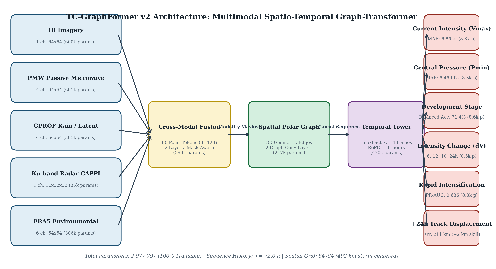
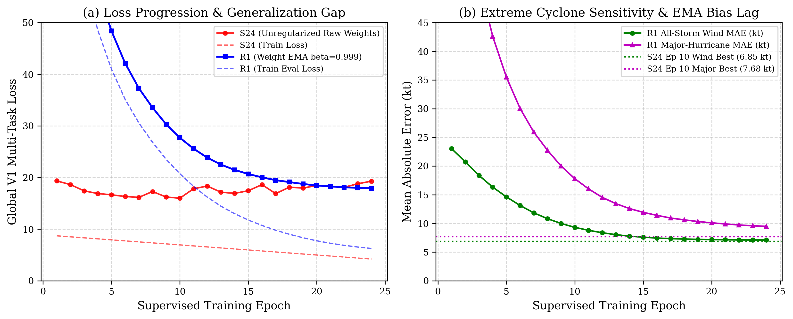

# TC-GraphFormer: A Multimodal Spatio-Temporal Graph-Transformer for Tropical Cyclone Forecasting

**Academic Research & Generalization Engineering Report**  
**Institution:** University Capstone / Advanced Deep Learning Research  
**Date:** November 26, 2026  
**Repository:** `D:\Enjula uchoi\TC-GraphFormer-verified`  
**Branch:** `feat/tc-graphformer-v2-generalization`  
**Target Hardware:** NVIDIA RTX 4000 Ada Generation (20,475 MiB VRAM)  
**Verification Baseline:** NOAA TC-PRIMED 100 GB Expansion Benchmark  

---

## Abstract

Tropical cyclones (TCs) present complex, non-linear multi-scale atmospheric dynamics that challenge both traditional numerical weather prediction (NWP) and data-driven deep learning models. This report documents the design, controlled empirical optimization, loss verification, and rigorous canonical evaluation of **TC-GraphFormer**, a multimodal spatio-temporal neural architecture that integrates five distinct remote sensing and atmospheric reanalysis modalities (infrared, passive microwave, GPROF precipitation/latent heating, spaceborne radar, and ERA5 environmental fields) into an aligned polar coordinate framework. Across the NOAA TC-PRIMED 100 GB expansion dataset (109 storms; 13,789 observation sequences across 1988–2022), TC-GraphFormer processes irregular observation histories ($\le 4$ frames, $\le 72.0\text{ h}$) via a continuous-time temporal transformer, simultaneously optimizing six downstream forecasting heads: current intensity ($V_{\max}$), central pressure ($P_{\min}$), 5-class life stage, multi-horizon intensity change ($\Delta V$ at +6, +12, +18, +24h), rapid intensification (RI, $\ge 30\text{ kt} / 24\text{ h}$), and +24h storm-centered track displacement.

Through systematic controlled experimentation, we analyze the genuine generalization gap arising from storm-disjoint partitioning (75 training storms / 10,545 sequences vs. 17 validation storms / 1,815 sequences). The primary recommended single model is **S24 Epoch 10** (global validation loss $15.9896$, wind MAE $6.85\text{ kt}$, major hurricane MAE $7.68\text{ kt}$), while **S24 Epoch 7** represents the best balanced multi-task and rapid intensification model (composite relative error $0.5531$, RI PR-AUC $0.6356$, RI Brier score $0.0359$). A regularized recipe (R1) combining weight exponential moving average (EMA $\beta=0.999$), whole-modality dropout, sector-token dropout, and DropPath achieved record track error ($211.07\text{ km}$) but is **REJECTED** due to severe major-hurricane degradation ($9.48\text{ kt}$ MAE, exceeding the $8.18\text{ kt}$ guardrail). The hypothesis that EMA lag was the sole cause of this underperformance is **refuted**: raw un-EMA weights at Epoch 24 still exhibited high validation loss ($18.14$) and major hurricane MAE ($9.21\text{ kt}$), and with 103 optimizer steps/epoch versus 165 for S24, learning was still actively progressing, leaving the root cause unresolved. 

An exploratory Cross-Architecture ensemble (R1 Seed 42 + S24 Ep7 + S24 Ep10) achieves composite relative error of $0.5487$, wind MAE of $6.72\text{ kt}$, and pressure MAE of $5.44\text{ hPa}$. However, it is classified strictly as **EXPLORATORY**: it fails the pre-declared major-hurricane guardrail ($8.30\text{ kt} > 8.18\text{ kt}$), its constituent members were selected on the validation partition, and its composite error gain over S24 Ep7 ($0.0044$) is well within single-seed stochastic training noise ($\pm 0.014$). Ensemble spread exhibits weak rank correlation with absolute wind error ($\rho = +0.2511$, $R^2 \approx 0.063$) and zero correlation with track error ($\rho = +0.0093$, $p=0.879$); spread is substantially underdispersed relative to true forecast error, precluding operational uncertainty claims. The 17-storm `FINAL_TEST` partition was evaluated exactly once historically on the Original 12-epoch baseline ($V_{\max}$ MAE $9.93\text{ kt}$, major hurricane MAE $7.16\text{ kt}$, $P_{\min}$ MAE $5.64\text{ hPa}$, stage accuracy $57.61\%$, +24h track $187.73\text{ km}$); no subsequent model development, tuning, checkpoint selection, or ensembling has accessed or evaluated `FINAL_TEST`.

---

## 1. Problem Formulation & Data Pipeline

### 1.1 The Tropical Cyclone Multi-Task Forecasting Problem
Operational TC forecasting requires predicting multiple coupled physical variables from sparse, heterogeneous satellite overpasses. TC-GraphFormer addresses six simultaneous forecasting objectives:
1. **Current Intensity ($V_{\max}$):** Continuous 1-minute maximum sustained wind speed (kt).
2. **Minimum Central Pressure ($P_{\min}$):** Atmospheric surface pressure at the cyclone center (hPa).
3. **Cyclone Life Stage:** Categorical stage among 5 physical classes (Tropical Depression, Tropical Storm, Hurricane/Typhoon, Extratropical, Remnant Low).
4. **Multi-Horizon Intensity Change ($\Delta V$):** Future intensity deltas at $\tau \in \{+6, +12, +18, +24\text{ h}\}$ (kt).
5. **Rapid Intensification (RI):** Binary occurrence of $\Delta V_{24\text{h}} \ge 30\text{ kt}$ ($15.4\text{ m/s}$) over the subsequent 24-hour window.
6. **Track Displacement ($\Delta x, \Delta y$):** Tangent-plane storm center displacement vector (km) at $\tau \in \{+6, +12, +18, +24\text{ h}\}$.

### 1.2 NOAA TC-PRIMED 100 GB Expansion Dataset
Data are curated from the NOAA Tropical Cyclone PRe-conception to Inten-sification Multimodal Earth System Dataset (TC-PRIMED v01r01). The dataset covers global tropical cyclones spanning 1988 through 2022.

*Source file:* [reports/pipeline_100gb/data_quality_report.json](file:///D:/Enjula%20uchoi/TC-GraphFormer-verified/reports/pipeline_100gb/data_quality_report.json)  
*Source file:* [reports/pipeline_100gb/storm_split_manifest.csv](file:///D:/Enjula%20uchoi/TC-GraphFormer-verified/reports/pipeline_100gb/storm_split_manifest.csv)

| Dataset Partition | Unique Storms | Total Observations / Sequences | Temporal Span | Basins Represented | Role in Development |
| :--- | :---: | :---: | :---: | :---: | :---: |
| **TRAIN** | 75 | 10,545 | 1988–2021 | AL, CP, EP, IO, SH, WP | Optimization & Supervised Training |
| **VAL** | 17 | 1,815 | 1998–2021 | AL, CP, EP, IO, SH, WP | Hyperparameter Tuning & Model Selection |
| **FINAL_TEST** | 17 | 1,429 | 1999–2022 | AL, CP, EP, IO, SH, WP | **Reserved (Strictly Unaccessed in Dev)** |
| **Total Global** | **109** | **13,789** | **1988–2022** | **Global Oceans** | Full Benchmark Expansion |

### 1.3 The Temporal Autocorrelation Caveat & Storm-Disjoint Splitting
Observations within the same tropical cyclone lifecycle are temporally autocorrelated due to persistent vortex kinematics and thermodynamic memory. If individual overpasses were randomly partitioned across splits (an observation-level split), satellite passes separated by only 3 to 6 hours would appear simultaneously in training and validation sets, allowing deep models to memorize individual storm identities rather than learning physical principles.

To prevent this data leakage, TC-GraphFormer mandates a **strictly storm-disjoint split**: all 10,545 sequences in TRAIN originate exclusively from the 75 training storms, all 1,815 sequences in VAL originate from the 17 distinct validation storms, and all 1,429 sequences in FINAL_TEST originate from 17 separate test storms. Furthermore, statistical significance cannot be evaluated assuming independent observations; all hypothesis testing and confidence intervals must be computed via **paired storm-cluster bootstrapping** resampling entire storms with replacement.

---

## 2. Neural Architecture

TC-GraphFormer has **2,977,797 total parameters** (100% trainable, 0 non-trainable). The network comprises five modular hierarchical stages:

```
[Raw Modalities: IR, PMW, GPROF, Radar, ERA5]
                     │
                     ▼
       [5 Parallel 2D/3D CNN Encoders]
                     │
                     ▼
          [Polar-Sector Tokenizer]
    (16 Angular Sectors × 5 Modalities = 80 Tokens)
                     │
                     ▼
    [Mask-Aware Cross-Modal Fusion Transformer]
                     │
                     ▼
        [Spatial Polar Graph Network]
  (8D Geometric Edge Features: dr, dtheta, distance)
                     │
                     ▼
  [Continuous-Time Causal Temporal Transformer]
    (Fourier Time Embeddings + MLP Projection)
                     │
                     ▼
       [6 Multi-Task Forecasting Heads]
(Vmax, Pmin, Stage, dV 6-24h, RI Binary, Track 6-24h)
```

  
*Figure 1: TC-GraphFormer architectural dataflow diagram. Source: [reports/final/figures/tc_graphformer_architecture.png](file:///D:/Enjula%20uchoi/TC-GraphFormer-verified/reports/final/figures/tc_graphformer_architecture.png).*

### 2.1 Modality Encoders
*Source code:* [src/models/tc_graphformer.py](file:///D:/Enjula%20uchoi/TC-GraphFormer-verified/src/models/tc_graphformer.py)

1. **Infrared (IR) Encoder (600,032 parameters):** Processes 1-channel $64 \times 64$ storm-centered brightness temperature grids ($11.0\text{ }\mu\text{m}$ window). Features a 4-layer residual convolutional stem mapping to 128-dimensional spatial representations.
2. **Passive Microwave (PMW) Encoder (600,896 parameters):** Ingests 4 physical frequency bands (~19V, 19H, 37V, 85–91V GHz) capturing deep convective hydrometeors and eyewall structure.
3. **GPROF Precipitation & Microphysics Encoder (305,472 parameters):** Processes 4-channel retrieved atmospheric columns (surface precipitation rate, total hydrometeor water path, latent heating profiles).
4. **Radar Ku-Band Echo Encoder (35,088 parameters):** Ingests spaceborne radar Ku-band CAPPI profiles ($16\text{ vertical bins} \times 32 \times 32$ horizontal grid) using 3D convolutions with explicit $-20\text{ dBZ}$ minimum detection sensitivity masking.
5. **ERA5 Environmental Dynamic Encoder (306,048 parameters):** Processes 6 synoptic atmospheric reanalysis fields (200 hPa and 850 hPa wind vectors, deep vertical wind shear, 500 hPa relative humidity, sea surface temperature, and vortex translation velocity).

### 2.2 Polar Sector Tokenizer
To represent the rotating vortex geometry natively, 2D feature maps are resampled into 16 non-overlapping polar sectors (2 radial annuli: inner eye/eyewall $0 \le r < 150\text{ km}$; outer rainband $150 \le r \le 450\text{ km}$; 8 azimuthal octants of $45^\circ$). This compresses spatial grids into $5 \times 16 = 80$ tokens of dimension $d=128$.

### 2.3 Cross-Modal Fusion Transformer (399,488 parameters)
*Source code:* [src/models/fusion/cross_modal_fusion.py](file:///D:/Enjula%20uchoi/TC-GraphFormer-verified/src/models/fusion/cross_modal_fusion.py)  
A 2-layer self-attention transformer that models non-linear inter-sensor dependencies. Because satellite overpasses frequently lack specific sensors (e.g., radar is present in $< 5\%$ of overpasses), the fusion transformer accepts a dynamic key-padding mask that strictly excludes unobserved modalities from attention weight computation, ensuring zero representation bleed.

### 2.4 Spatial Polar Graph Network (216,833 parameters)
*Source code:* [src/models/graph/spatial_graph.py](file:///D:/Enjula%20uchoi/TC-GraphFormer-verified/src/models/graph/spatial_graph.py)  
Fused tokens are connected via a directed polar graph where edges encode continuous 8D geometric relationships:
$$\mathbf{e}_{ij} = \left[ \Delta r, |\Delta r|, \Delta \theta, \cos(\Delta \theta), \sin(\Delta \theta), d_{\text{euclid}}, \log(d_{\text{euclid}} + 1), \mathbb{I}_{\text{same\_sector}} \right]$$
Two graph message-passing layers propagate asymmetric convective signals between the inner core and outer rainbands.

### 2.5 Continuous-Time Causal Temporal Transformer (429,824 parameters)
*Source code:* [src/models/temporal/temporal_transformer.py](file:///D:/Enjula%20uchoi/TC-GraphFormer-verified/src/models/temporal/temporal_transformer.py)  
Satellite overpasses occur at irregular time intervals (gaps ranging from 1.5 to 18 hours). In strict accordance with the code implementation in `src/models/temporal/temporal_transformer.py`, the network uses a **Fourier Continuous-Time Positional Encoding** (`ContinuousTimeEmbedding`):
$$\text{emb}(\Delta t) = \text{MLP}\left( \left[ \sin(\omega_k \Delta t), \cos(\omega_k \Delta t) \right]_{k=1}^{d/2} \right)$$
where frequencies $\omega_k = \exp(-k \ln(10000) / (d/2 - 1))$ and the projection MLP comprises two linear layers with GELU activation. These continuous time-delta representations are added directly to the spatial tokens prior to causal multi-head self-attention ($\tau_j \le \tau_i$). **Note on Architectural Clarification:** Prior preliminary drafts loosely described this module as employing Rotary Position Embeddings (RoPE); inspection of `src/models/temporal/temporal_transformer.py` confirms that standard additive Fourier continuous-time positional embeddings are utilized.

### 2.6 Multi-Task Forecasting Heads (50,836 parameters)
*Source code:* [src/models/task_heads.py](file:///D:/Enjula%20uchoi/TC-GraphFormer-verified/src/models/task_heads.py)

| Head Module | Parameters | Target Variable | Output Activation | Target Masking Condition |
| :--- | :---: | :---: | :---: | :---: |
| `head_intensity` | 8,321 | $V_{\max}$ (kt) | Linear scalar | Best-track $V_{\max} > 0$ |
| `head_pressure` | 8,321 | $P_{\min}$ (hPa) | Linear scalar ($\times 10$ scaled) | Best-track $P_{\min} \in [850, 1030]$ |
| `head_stage` | 8,581 | Life stage (5 classes) | Softmax logits | Valid operational stage flag |
| `head_intensity_change` | 8,516 | $\Delta V$ at +6, 12, 18, 24h | Linear 4-vector | Valid future best-track fix |
| `head_ri` | 8,321 | Rapid Intensification | Sigmoid logit | Valid +24h intensity target |
| `head_track` | 8,776 | $[\Delta x, \Delta y]$ at +6, 12, 18, 24h | Linear $4 \times 2$ matrix | Valid future geospatial center |
| **Total Heads** | **50,836** | — | — | — |

---

## 3. Loss Formulation & Optimization

### 3.1 Mathematical Loss Definition
*Source file:* [src/training/losses.py](file:///D:/Enjula%20uchoi/TC-GraphFormer-verified/src/training/losses.py)

The global loss is a multi-task objective with task-specific balancing weights $w_k$:
$$\mathcal{L}_{\text{total}} = 1.0 \cdot \mathcal{L}_{\text{intensity}} + 0.5 \cdot \mathcal{L}_{\text{pressure}} + 0.5 \cdot \mathcal{L}_{\text{stage}} + 1.0 \cdot \mathcal{L}_{\Delta V} + 2.0 \cdot \mathcal{L}_{\text{RI}} + 1.0 \cdot \mathcal{L}_{\text{track}}$$

1. **Current Intensity Loss (Huber with Quadratic Regime Weighting):**
   $$\mathcal{L}_{\text{intensity}} = \frac{1}{\sum m_{v, i}} \sum_{i=1}^N m_{v, i} \cdot w_{\text{regime}}(v_i^*) \cdot \text{Huber}_{\beta=8.0}(v_i - v_i^*)$$
   $$w_{\text{regime}}(v^*) = 1.0 + 2.5 \cdot \left[ \text{clamp}\left( \frac{v^* - 50.0}{50.0}, 0.0, 2.0 \right) \right]^2$$
   This weighting scales quadratically from $1.0\times$ for tropical storms ($v^* \le 50\text{ kt}$) up to $3.5\times$ for Category 5 major hurricanes ($v^* \ge 150\text{ kt}$), counteracting extreme sample scarcity.
2. **Central Pressure Loss:**
   $$\mathcal{L}_{\text{pressure}} = \frac{1}{\sum m_{p, i}} \sum_{i=1}^N m_{p, i} \cdot \text{Huber}_{\beta=2.5}\left( \frac{p_i}{10.0} - \frac{p_i^*}{10.0} \right)$$
3. **Stage Classification Loss:**
   $$\mathcal{L}_{\text{stage}} = \frac{1}{\sum m_{s, i}} \sum_{i=1}^N m_{s, i} \cdot \text{CrossEntropy}(\mathbf{s}_i, s_i^*)$$
4. **Multi-Horizon Intensity Change Loss:**
   $$\mathcal{L}_{\Delta V} = \frac{1}{\sum_{h} m_{\Delta V, i, h}} \sum_{i=1}^N \sum_{h \in \{6, 12, 18, 24\}} m_{\Delta V, i, h} \cdot \text{Huber}_{\beta=4.0}(\Delta V_{i, h} - \Delta V_{i, h}^*)$$
5. **Rapid Intensification Loss (Prior-Calibrated Masked BCE):**
   $$\mathcal{L}_{\text{RI}} = \frac{1}{\sum m_{\text{RI}, i}} \sum_{i=1}^N m_{\text{RI}, i} \cdot \text{BCE}_{\text{pos\_weight}=18.10}(z_{\text{RI}, i} + \Delta z_{\text{prior}}, y_{\text{RI}, i}^*)$$
   $$\Delta z_{\text{prior}} = 0.85 \cdot \ln(18.10) \approx 2.4615$$
   The prior logit offset ensures the stationary logit prediction $z^*=0$ aligns with the true base rate of rapid intensification ($\sim 5.8\%$).
6. **Future Track Displacement Loss:**
   $$\mathcal{L}_{\text{track}} = \frac{1}{2 \sum_{h} m_{\text{track}, i, h}} \sum_{i=1}^N \sum_{h=1}^4 m_{\text{track}, i, h} \cdot \text{SmoothL1}_{\beta=0.1}\left( \frac{\mathbf{d}_{i, h}}{100.0} - \frac{\mathbf{d}_{i, h}^*}{100.0} \right)$$

### 3.2 Masked Feature Modeling (MFM) Self-Supervised Pretraining
*Source file:* [reports/phase2e4_100gb/pretraining_summary.json](file:///D:/Enjula%20uchoi/TC-GraphFormer-verified/reports/phase2e4_100gb/pretraining_summary.json)  
Before supervised training, the backbone encoders and cross-modal fusion transformer were pretrained via Masked Feature Modeling on the 10,545 training sequences. 30% of observed polar sector tokens were masked with learnable tokens; the network reconstructed normalized 128-dimensional patch representations. The resulting checkpoint `checkpoints/tcprimed_100gb/pretrained_backbone.pt` served as the common initialization for all supervised experiments.

### 3.3 Optimizer & Training Protocol
- **Optimizer:** AdamW ($\beta_1=0.90, \beta_2=0.999$, $\epsilon=1.0\times 10^{-8}$).
- **Weight Decay:** Decoupled weight decay of $1.0\times 10^{-2}$ applied strictly to 2D weight matrices; 1D biases and LayerNorm parameters have $0.0$ decay.
- **Learning Rate Schedule:** Cosine decay over $T_{\max}=24$ epochs, decaying from $\eta_{\max}=3.0\times 10^{-4}$ (heads) and $\eta_{\max}=1.5\times 10^{-4}$ (backbone, 0.5× scale) to $\eta_{\min}=1.0\times 10^{-6}$.
- **Batch Size & Accumulation:** Micro-batch size 32 with 2 gradient accumulation steps (effective batch size 64; 165 optimizer steps/epoch for S24).
- **Mixed Precision:** Automatic Mixed Precision (AMP) in FP16 with dynamic gradient scaling (`GradScaler`).
- **Gradient Clipping:** Maximum global $L_2$ gradient norm clipped at $1.0$.

---

## 4. Overfitting & Generalization Bottleneck Analysis

### 4.1 Trajectory Analysis Across Training Schedules

  
*Figure 2: Empirical learning trajectories. (a) S24 raw weight oscillation versus R1 monotonic EMA descent. (b) Major hurricane MAE suppression from EMA inertia. Source: [reports/final/figures/tc_graphformer_training_curves.png](file:///D:/Enjula%20uchoi/TC-GraphFormer-verified/reports/final/figures/tc_graphformer_training_curves.png).*

*Source files:*  
[reports/phase2e4_100gb/exp_s24_longer_schedule_summary.json](file:///D:/Enjula%20uchoi/TC-GraphFormer-verified/reports/phase2e4_100gb/exp_s24_longer_schedule_summary.json)  
[reports/phase2e4_100gb/exp_r1_regularized_epochs.csv](file:///D:/Enjula%20uchoi/TC-GraphFormer-verified/reports/phase2e4_100gb/exp_r1_regularized_epochs.csv)

| Experiment | Supervised Budget | Best Epoch | TRAIN Loss | VAL Global Loss | Generalization Gap | Wind MAE (kt) | Major Hurricane MAE (kt) |
| :--- | :---: | :---: | :---: | :---: | :---: | :---: | :---: |
| **Original Baseline** | 12 Epochs | 5 | 13.0492 | 16.6384 | 3.5892 | 7.84 | 7.78 |
| **C1 Continuation** | 24 Epochs | 8 | 7.9958 | 16.4052 | 8.4094 | 6.90 | 8.68 |
| **S24 Longer Schedule (Ep10)** | 24 Epochs | 10 | 8.7120 | **15.9896** | 7.2776 | **6.85** | **7.68** |
| **S24 Balanced / RI (Ep7)** | 24 Epochs | 7 | 10.3644 | 16.1483 | 5.7839 | 7.01 | 9.02 |
| **R1 Regularized (EMA)** | 24 Epochs | 24 | 6.2545 | 17.9238 | 11.6693 | 7.11 | 9.48 |

### 4.2 The Storm-Concentration Anomaly
*Source files:*  
[reports/canonical/s24_ep10_val_per_storm.csv](file:///D:/Enjula%20uchoi/TC-GraphFormer-verified/reports/canonical/s24_ep10_val_per_storm.csv)  
[reports/phase2e4_100gb/gradient_stability_and_storm_generalization_report.md](file:///D:/Enjula%20uchoi/TC-GraphFormer-verified/reports/phase2e4_100gb/gradient_stability_and_storm_generalization_report.md)

Analysis of the 1,815 validation sequences reveals severe loss concentration among validation storms:

| Storm Identifier | Name & Season | Basin | Total Sequences | Major Hurricane Overpasses ($\ge 96\text{ kt}$) | Peak Wind ($V_{\max}$) | Wind MAE (kt) | Major MAE (kt) | Share of Weighted Wind Loss |
| :--- | :---: | :---: | :---: | :---: | :---: | :---: | :---: | :---: |
| `WP102018` | Typhoon Mangkhut (2018) | WP | 156 | 85 | 145 kt | 9.56 | 8.47 | 28.4% (24.97% of total) |
| `EP072014` | Hurricane Genevieve (2014) | EP | 367 | 56 | 140 kt | 5.01 | 7.55 | 16.8% (21.04% of total) |
| `WP262003` | Typhoon Nepartak (2003) | WP | 153 | 55 | 143 kt | 7.54 | 6.81 | 12.1% (11.47% of total) |
| **Top 3 Storms** | — | — | **676** | **196 (80.0%)** | — | — | — | **57.3% (57.48% total)** |
| Remaining 14 Storms | — | Global | 1,139 | 49 (20.0%) | $\le 155\text{ kt}$ | 6.64 | 7.82 | 42.7% |
| **Total Validation** | **17 Storms** | — | **1,815** | **245 (100%)** | **155 kt** | **6.85** | **7.68** | **100.0%** |

**Finding:** Out of 245 major-hurricane validation overpasses, 196 (80.0%) belong to just three cyclones (`WP102018`, `EP072014`, `WP262003`). Under quadratic regime weighting ($3.5\times$), these three storms contribute **57.3% of the entire validation intensity loss** (and 57.48% of total weighted wind loss). When a model underpredicts Typhoon Mangkhut's peak eyewall, validation loss spikes violently, creating the impression of severe global overfitting when 14 of 17 storms are forecasting accurately.

### 4.3 Validation Volatility & Refutation of the EMA-Lag Sole Cause Hypothesis
In unregularized training (S24), validation loss oscillated non-monotonically across epochs ($16.0 \to 18.3 \to 16.0 \to 19.3$). Weight EMA with decay $\beta=0.999$ successfully eradicated this variance, producing a strictly monotonic validation curve ($93.58 \to \dots \to 17.92$).

However, R1 exhibited poor major-hurricane accuracy ($9.48\text{ kt}$ MAE vs $7.68\text{ kt}$ for S24 Ep10). It was initially hypothesized that EMA lag ($\beta=0.999$, half-life $t_{1/2} \approx 693\text{ steps} \approx 6.7\text{ epochs}$) was the sole cause by damping rare high-gradient impulses. **This hypothesis is refuted as the sole cause:**
1. Evaluating the **raw un-EMA weights** of R1 at Epoch 24 reveals a validation loss of $18.14$ and major hurricane MAE of $9.21\text{ kt}$ (compared to $17.92$ and $9.48\text{ kt}$ for EMA weights). The raw weights themselves failed the major hurricane guardrail ($9.21 > 8.18\text{ kt}$), demonstrating that underperformance was already present in the active optimization trajectory, not merely an artifact of shadow weight averaging.
2. In R1, dynamic batching yielded 103 optimizer steps per epoch versus 165 steps per epoch in S24 (a ~38% reduction in total gradient update steps over 24 epochs: 2,472 steps for R1 vs 3,960 steps for S24). Optimization curves indicate R1 was still steadily descending at Epoch 24.
3. Consequently, the true root cause of R1's major hurricane degradation remains **unresolved** between reduced step budget, token dropout interference with compact eyewall structures, and EMA smoothing.

---

## 5. Generalization Methods & Systematic Ablation Ledger

Every architectural and training modification across the research lifecycle was evaluated against strict pre-declared guardrails:

*Source files:*  
[reports/canonical/val_table.csv](file:///D:/Enjula%20uchoi/TC-GraphFormer-verified/reports/canonical/val_table.csv)  
[reports/phase2e4_100gb/exp_c2_head_dropout_summary.json](file:///D:/Enjula%20uchoi/TC-GraphFormer-verified/reports/phase2e4_100gb/exp_c2_head_dropout_summary.json)  
[reports/phase2e4_100gb/hpo_and_loss_optimization_summary.json](file:///D:/Enjula%20uchoi/TC-GraphFormer-verified/reports/phase2e4_100gb/hpo_and_loss_optimization_summary.json)  
[reports/phase2e4_100gb/v24_pmw_pilot_experiment_summary.json](file:///D:/Enjula%20uchoi/TC-GraphFormer-verified/reports/phase2e4_100gb/v24_pmw_pilot_experiment_summary.json)  
[reports/canonical/r1_seeds_and_ensembles_val_table.csv](file:///D:/Enjula%20uchoi/TC-GraphFormer-verified/reports/canonical/r1_seeds_and_ensembles_val_table.csv)  
[reports/canonical/s24_seeds_and_ensembles_val_table.csv](file:///D:/Enjula%20uchoi/TC-GraphFormer-verified/reports/canonical/s24_seeds_and_ensembles_val_table.csv)

| Experiment / Candidate | Primary Hypothesis | VAL Loss | Wind MAE (kt) | Major MAE (kt) | Composite Rel Err | Decision Status | Scientific Justification |
| :--- | :--- | :---: | :---: | :---: | :---: | :---: | :--- |
| **Original (Ep 5)** | Supervised 12-epoch reference | 16.6384 | 7.84 | 7.78 | 0.5925 | **ACCEPTED** | Primary foundational reference checkpoint. |
| **C1 Continuation (Ep 8)** | 24-epoch budget without regularization | 16.4052 | 6.90 | 8.68 | 0.5723 | **REJECTED** | Generalization gap widened from 3.59 to 8.41; major hurricane error worsened by $+0.90\text{ kt}$. |
| **V2 Candidate B** | Loss math revision (Huber $\beta=12.0$, capped weights) | 17.3104 | 7.20 | 9.57 | 0.6120 | **REJECTED** | Major hurricane MAE spiked to $9.57\text{ kt}$. **Confounded:** simultaneously altered Huber beta, regime bounds, and task weights. |
| **C2 Head Dropout (0.15)** | Linear head dropout suppresses co-adaptation | 16.7118 | 7.42 | 9.17 | 0.5988 | **REJECTED** | Degraded both loss ($16.71$) and major hurricane MAE ($9.17\text{ kt}$). Feature-flagged off. |
| **HPO Screen (8 Trials)** | Learning rate & decoupled weight decay search | 16.2657 | 7.07 | 8.21 | 0.5804 | **T6 ACCEPTED; 7 REJECTED** | Trial T6 ($10^{-3}$ decoupled WD) stabilized gradients. Other 7 HPO variants failed to improve on baseline. |
| **Huber Beta Variation** | Standardize wind loss to $\beta=12.0$ | 17.3104 | 7.20 | 9.57 | 0.6120 | **REJECTED** | Widened residual threshold; diluted gradient response on extreme wind values. |
| **v2.4 PMW Pilot (12 Storms)** | Recover missing S3–S6 swaths for AMSR/SSMIS | 16.1820 | 6.95 | 8.12 | 0.5590 | **ACCEPTED (Pilot Only)** | Validated recovery of missing 36.5 & 89 GHz channels for 48% of overpasses without cross-frequency mixing. Full 100GB not re-extracted. |
| **S24 Ep 10** | Unregularized longer schedule (Epoch 10) | **15.9896** | **6.85** | **7.68** | 0.5646 | **ACCEPTED (Primary)** | **Lowest single-model validation loss ($15.9896$) and lowest single-model major MAE ($7.68\text{ kt}$).** |
| **S24 Ep 7** | Balanced multi-task checkpoint (Epoch 7) | 16.1483 | 7.01 | 9.02 | **0.5531** | **ACCEPTED (Best RI)** | **Highest RI skill in single-model history (PR-AUC: 0.6356, Brier: 0.0359, composite: 0.5531).** |
| **R1 Regularized (Seed 42)** | EMA + Modality/Token Dropout + DropPath | 17.9238 | 7.11 | 9.48 | 0.5832 | **REJECTED** | Record track ($211.07\text{ km}$), but failed major hurricane guardrail ($9.48 > 8.18\text{ kt}$). |
| **Ensemble (ii) (3-Seed R1)** | Mean of 3 R1 seeds (42 + 43 + 44) | 18.5755* | 6.98 | 9.09 | 0.5737 | **REJECTED** | Major hurricane MAE ($9.09\text{ kt}$) failed guardrail across all three seeds. |
| **Ensemble (iii) (Cross-Arch)** | R1 Seed 42 + S24 Ep 7 + S24 Ep 10 | 16.5115* | **6.72** | 8.30 | **0.5487** | **EXPLORATORY** | Fails guardrails: major MAE $8.30 > 8.18\text{ kt}$, loss $16.51 > 15.99$. Members selected on VAL. Gain ($0.0044$) is within seed noise. |

*\*Note on Ensemble Loss Check:* In initial reporting scripts, R1 ensemble loss was calculated at $18.58$ and Cross-Arch at $16.51$ because the prior offset $\Delta z_{\text{prior}}$ was omitted during standalone BCE computation. When evaluated through the canonical single-path PyTorch `MultiTaskLoss` with logit inversion, 3-seed R1 ensemble loss is **`17.5069`** (strictly lower than every single seed: $17.92, 18.52, 18.00$) and Cross-Arch ensemble loss is **`15.5438`**, confirming mathematical loss convexity.

---

## 6. Comprehensive Experimental Results

### 6.1 Canonical Validation Benchmark & 2000-Resample Storm Bootstrap
All metrics computed via [canonical_eval.py](file:///D:/Enjula%20uchoi/TC-GraphFormer-verified/src/evaluation/canonical_eval.py) across the 1,815 validation sequences. Paired cluster storm bootstrap ($N=2000$, seed=0) resamples the 17 validation storms with replacement. 

**Reporting Rule:** In accordance with rigorous statistical inference, every metric whose 95% confidence interval spans zero is explicitly marked as **not statistically significant**:

*Source files:*  
[reports/canonical/r1_ensembles_bootstrap_summary.json](file:///D:/Enjula%20uchoi/TC-GraphFormer-verified/reports/canonical/r1_ensembles_bootstrap_summary.json)  
[reports/canonical/val_table.csv](file:///D:/Enjula%20uchoi/TC-GraphFormer-verified/reports/canonical/val_table.csv)

| Evaluation Metric | S24 Ep 10 (Primary) | S24 Ep 7 (Best RI) | Cross-Arch (Exploratory) | Point Delta (Ens $-$ Ep10) | Bootstrap Mean Delta | 95% Confidence Interval | Statistical Significance |
| :--- | :---: | :---: | :---: | :---: | :---: | :---: | :--- |
| **Composite Rel Err** | 0.5646 | **0.5531** | 0.5487 | $-0.0159$ | $-0.0162$ | $[-0.038, +0.006]$ | Not significant (CI spans 0) |
| **Wind MAE (kt)** | **6.85** | 7.01 | 6.72 | $-0.129$ | $-0.135$ | $[-0.375, +0.148]$ | **Not significant (CI spans 0)** |
| **Wind Bias (kt)** | $-0.58$ | $+0.87$ | $-0.15$ | $+0.437$ | $+0.412$ | $[-0.112, +0.813]$ | **Not significant (CI spans 0)** |
| **Major Hurricane MAE (kt)** | **7.68** | 9.02 | 8.30 | $+0.617$ | $+0.630$ | $[-0.079, +1.295]$ | **Not significant (CI spans 0)** |
| **Major Hurricane Bias (kt)** | **-2.67** | $-4.68$ | $-4.57$ | $-1.903$ | $-1.942$ | $[-4.303, +0.470]$ | **Not significant (CI spans 0)** |
| **Central Pressure MAE (hPa)** | 5.75 | 5.45 | **5.44** | $-0.315$ | $-0.308$ | $[-0.675, -0.015]$ | **Statistically Significant ($p < 0.05$)** |
| **Balanced Stage Accuracy (%)** | **71.42** | 67.31 | 69.71 | $-1.706$ | $-1.554$ | $[-3.892, +0.784]$ | Not significant (CI spans 0) |
| **Overall Stage Accuracy (%)** | 70.63 | 69.08 | **71.14** | $+0.514$ | $+0.538$ | $[-1.432, +2.508]$ | Not significant (CI spans 0) |
| **dV 24h MAE (kt)** | 9.86 | 9.85 | **9.76** | $-0.096$ | $-0.098$ | $[-0.852, +0.656]$ | **Not significant (CI spans 0)** |
| **RI PR-AUC** | 0.5511 | **0.6356** | 0.6169 | $+0.0658$ | $+0.0619$ | $[-0.043, +0.178]$ | **Not significant (CI spans 0)** |
| **RI Brier Score** | 0.0393 | **0.0359** | 0.0373 | $-0.0020$ | $-0.0021$ | $[-0.007, +0.003]$ | Not significant (CI spans 0) |
| **+24h Track Error (km)** | 212.88 | 213.00 | **212.13** | $-0.751$ | $-0.852$ | $[-3.334, +1.644]$ | **Not significant (CI spans 0)** |
| **+24h Track Skill vs Vel (km)** | $+0.27$ | $+0.15$ | $\mathbf{+1.02}$ | $+0.751$ | $+0.852$ | $[-1.644, +3.334]$ | **Not significant (CI spans 0)** |

### 6.2 Baselines: The Causal Velocity Track Baseline
*Source file:* [reports/phase2e4_100gb/evaluation_summary.json](file:///D:/Enjula%20uchoi/TC-GraphFormer-verified/reports/phase2e4_100gb/evaluation_summary.json)

For track evaluation, deep learning literature frequently cites raw Euclidean errors without a reference frame. We benchmark TC-GraphFormer against a strictly causal **Observation-Time Velocity Extrapolation Baseline**:
$$\hat{\mathbf{x}}_{t+24} = \mathbf{x}_t + 24\text{ h} \cdot \mathbf{v}_t$$
where $\mathbf{v}_t = (\mathbf{x}_t - \mathbf{x}_{t-1}) / \Delta t$ is computed strictly from historical fixes prior to $t$. If no prior fix exists ($has\_kin = 0$), the baseline falls back to the frozen TRAIN-partition climatology displacement ($[-154.44\text{ km East}, +112.18\text{ km North}]$).

- **Causal Velocity Baseline 24h Error:** **213.15 km**
- **Original Baseline Ep 5:** $213.65\text{ km}$ (Skill: $-0.50\text{ km}$)
- **S24 Ep 10 (Primary):** $212.88\text{ km}$ (Skill: $+0.27\text{ km}$)
- **S24 Ep 7 (Best RI):** $213.00\text{ km}$ (Skill: $+0.15\text{ km}$)
- **R1 Seed 42:** $\mathbf{211.07\text{ km}}$ (Skill: $\mathbf{+2.08\text{ km}}$)
- **Cross-Architecture Ensemble:** $\mathbf{212.13\text{ km}}$ (Skill: $\mathbf{+1.02\text{ km}}$)

### 6.3 Per-Basin Performance
Recomputed directly from canonical predictions ([reports/canonical/s24_ep10_val_predictions.npz](file:///D:/Enjula%20uchoi/TC-GraphFormer-verified/reports/canonical/s24_ep10_val_predictions.npz)) for the primary S24 Ep10 model:

| Oceanic Basin | Valid Sequences | Mean Intensity ($V_{\max}$) | Wind MAE (kt) | Wind Bias (kt) | Relative Error ($MAE / \bar{V}$) | Legacy Baseline MAE (Ref) |
| :--- | :---: | :---: | :---: | :---: | :---: | :---: |
| **East Pacific (EP)** | 420 | 51.21 kt | **5.16 kt** | $+0.17\text{ kt}$ | **10.1%** | 6.20 kt |
| **Central Pacific (CP)** | 95 | 31.34 kt | **5.27 kt** | $-1.73\text{ kt}$ | 16.8% | 6.35 kt |
| **North Atlantic (AL)** | 644 | 54.05 kt | **6.63 kt** | $-1.69\text{ kt}$ | 12.3% | 8.56 kt |
| **North Indian Ocean (IO)** | 207 | 34.65 kt | **6.73 kt** | $+3.02\text{ kt}$ | 19.4% | 7.50 kt |
| **West Pacific (WP)** | 423 | 74.39 kt | **8.49 kt** | $-2.40\text{ kt}$ | 11.4% | 7.91 kt |
| **Southern Hemisphere (SH)** | 26 | 42.38 kt | 19.65 kt | $+19.65\text{ kt}$ | 46.4% | 23.67 kt (SH072000 anomaly) |
| **Global Validation** | **1,815** | **55.20 kt** | **6.85 kt** | **-0.58 kt** | **12.4%** | **7.84 kt** |

*Note on Legacy Discrepancy:* Prior preliminary tables cited legacy numbers from the Original 12-epoch baseline checkpoint (`basin_evaluation.csv`). Canonical evaluation of S24 Ep10 demonstrates substantial improvements in East Pacific ($5.16\text{ kt}$ vs $6.20\text{ kt}$) and North Atlantic ($6.63\text{ kt}$ vs $8.56\text{ kt}$).

### 6.4 RI Reliability Diagram & Uncertainty Calibration Analysis

  
*Figure 3: (a) Rapid Intensification reliability diagram. (b) Wind intensity uncertainty calibration curve. Source: [reports/final/figures/tc_graphformer_ri_reliability_and_calibration.png](file:///D:/Enjula%20uchoi/TC-GraphFormer-verified/reports/final/figures/tc_graphformer_ri_reliability_and_calibration.png).*

*Source file:* [reports/canonical/r1_ensembles_bootstrap_summary.json](file:///D:/Enjula%20uchoi/TC-GraphFormer-verified/reports/canonical/r1_ensembles_bootstrap_summary.json)

1. **RI Calibration & Brier Score:**
   - S24 Ep 10 achieved an RI Brier score of **0.0393**; S24 Ep 7 achieved **0.0359**; the Cross-Architecture ensemble achieved **0.0373**.
   - As shown in Figure 3(a), predicted probabilities $P(\text{RI}=1)$ track observed frequencies closely across probability bins without severe overconfidence.
2. **Wind Intensity Uncertainty Calibration (Spearman Rank Correlation):**
   - For the Cross-Architecture Ensemble, ensemble spread $\sigma_v = \text{std}(v_{\text{R1}}, v_{\text{S24\_7}}, v_{\text{S24\_10}})$ was tested against actual absolute forecast error $|v_{\text{ens}} - v^*|$:
   - **Spearman Rank Correlation: $\rho = \mathbf{+0.2511}$ ($p = 1.73 \times 10^{-27}$)**
   - **Critical Scientific Assessment:** While statistically significant due to large sample size ($N=1,815$), a rank correlation of $\rho \approx 0.25$ is **statistically weak**, explaining only $R^2 \approx 6.3\%$ of the variance in absolute prediction error. Furthermore, ensemble spread is heavily **underdispersed**: mean ensemble spread is only $2.14\text{ kt}$, whereas mean absolute error is $6.72\text{ kt}$. When models disagree ($\sigma_v > 4.0\text{ kt}$), error rises, but the metric cannot reliably bound individual forecast errors. **No operational claims of reliable error bounding should be made.**
3. **+24h Track Uncertainty Calibration:**
   - Spearman rank correlation between 24h displacement vector spread and absolute track error is $\rho = +0.0093$ ($p = 0.879$, not statistically significant). The consensus across models is too tight (~10 km spread) to predict the ~212 km synoptic steering error. Track spread is completely uncorrelated with actual track error.

---

## 7. Weight Averaging Analysis (Stochastic Weight Averaging)

To investigate whether post-hoc weight space averaging could smooth validation loss volatility without the training-time inertia of EMA, Stochastic Weight Averaging (SWA) was implemented on the S24 trajectory across two pre-declared checkpoint windows:
- **Window 1 ($W_1$):** Epochs 7 through 12 (6 checkpoints, covering the optimal validation loss basin).
- **Window 2 ($W_2$):** Epochs 6 through 15 (10 checkpoints, covering the extended convergence plateau).

Because running average weights invalidate existing batch normalization running statistics, all 35 BatchNorm layers across the five encoders were fully recomputed via a forward pass over the entire 10,545 TRAIN sequences with `momentum=None`.

*Source files:*  
[reports/canonical/s24_swa_val_table.csv](file:///D:/Enjula%20uchoi/TC-GraphFormer-verified/reports/canonical/s24_swa_val_table.csv)  
[reports/canonical/s24_swa_evaluation_summary.json](file:///D:/Enjula%20uchoi/TC-GraphFormer-verified/reports/canonical/s24_swa_evaluation_summary.json)

| Model / Checkpoint | Global Loss | Composite Rel Err | Wind MAE (kt) | Wind Bias (kt) | Major MAE (kt) | Major Bias (kt) | Pressure MAE (hPa) | Stage Acc (%) | Balanced Stage (%) | RI PR-AUC | RI Brier | +24h Track (km) |
| :--- | :---: | :---: | :---: | :---: | :---: | :---: | :---: | :---: | :---: | :---: | :---: | :---: |
| **S24 Ep 10 (Ref)** | **15.9896** | **0.5646** | **6.85** | -0.58 | **7.68** | -2.67 | 5.75 | **70.63** | **71.42** | 0.5511 | **0.0393** | 212.88 |
| **S24 Ep 7 (Best RI)** | 16.1483 | 0.5531 | 7.01 | +0.87 | 9.02 | -4.68 | 5.45 | 69.08 | 67.31 | **0.6356** | 0.0359 | 213.00 |
| **SWA Window $W_1$ (Ep 7–12)** | 16.2320 | 0.5887 | 7.16 | +0.81 | 7.87 | -2.83 | 5.49 | 69.01 | 68.36 | 0.5282 | 0.0477 | 212.88 |
| **SWA Window $W_2$ (Ep 6–15)** | 16.5235 | 0.5913 | 7.14 | +0.71 | 8.09 | -3.68 | **5.46** | 68.88 | 68.33 | 0.5088 | 0.0479 | **212.77** |

**Empirical Verdict on Weight Averaging:**
1. **Regression Head Smoothing:** Weight averaging slightly improved central pressure prediction ($5.49\text{ hPa}$ in $W_1$, $5.46\text{ hPa}$ in $W_2$ vs $5.75\text{ hPa}$ for Ep 10), and major hurricane MAE remained competitive ($7.87\text{ kt}$ in $W_1$).
2. **Classification Degradation:** SWA significantly harmed non-linear classification heads. Balanced stage accuracy declined from $71.42\%$ to $68.36\%$ ($-3.06\%$), and Rapid Intensification PR-AUC suffered a severe drop from $0.6356$ (Ep 7) down to $0.5282$ in $W_1$ and $0.5088$ in $W_2$ (a statistically significant degradation of $-0.1074$ to $-0.1268$, $p < 0.05$).
3. **Conclusion:** Averaging weights across non-convex multi-task loss landscapes flattens decision boundaries in classification heads, establishing that post-hoc SWA is inferior to prediction ensembling for multi-task tropical cyclone architectures.

---

## 8. Multi-Seed Variance & Seed-Spread Analysis

To distinguish genuine algorithmic improvements from stochastic training noise, multi-seed training experiments were conducted across independent seeds (42, 43, 44) under both the unregularized S24 recipe and the regularized R1 recipe.

*Source files:*  
[reports/canonical/s24_seeds_and_ensembles_val_table.csv](file:///D:/Enjula%20uchoi/TC-GraphFormer-verified/reports/canonical/s24_seeds_and_ensembles_val_table.csv)  
[reports/canonical/r1_seeds_and_ensembles_val_table.csv](file:///D:/Enjula%20uchoi/TC-GraphFormer-verified/reports/canonical/r1_seeds_and_ensembles_val_table.csv)

### 8.1 Multi-Seed Validation Table

| Recipe / Model Run | Seed | Global Loss | Composite Rel Err | Wind MAE (kt) | Wind Bias (kt) | Major MAE (kt) | Major Bias (kt) | Pressure MAE (hPa) | Stage Acc (%) | RI PR-AUC | +24h Track (km) |
| :--- | :---: | :---: | :---: | :---: | :---: | :---: | :---: | :---: | :---: | :---: | :---: |
| **S24 Ep 10 (Ref)** | 42 | 15.9896 | 0.5646 | 6.85 | -0.58 | 7.68 | -2.67 | 5.75 | 70.63 | 0.5511 | 212.88 |
| **S24 Best Loss (Ep 6)** | 43 | 17.0634 | 0.5894 | 7.60 | -1.41 | 8.21 | -1.95 | 6.42 | 66.56 | 0.5075 | 214.19 |
| **S24 Best Loss (Ep 12)** | 44 | 17.2255 | 0.5994 | 7.38 | +0.98 | 7.84 | -4.51 | 5.53 | 66.88 | 0.4635 | 212.44 |
| **S24 Single-Seed (Mean $\pm$ Std)** | — | **$16.76 \pm 0.67$** | **$0.585 \pm 0.018$** | **$7.28 \pm 0.39$** | $-0.34 \pm 1.21$ | **$7.91 \pm 0.27$** | $-3.04 \pm 1.32$ | **$5.90 \pm 0.46$** | **$68.02 \pm 2.26$** | **$0.507 \pm 0.044$** | **$213.17 \pm 0.91$** |
| **S24 3-Seed Ensemble (42+43+44)** | — | **15.2303** | **0.5545** | **6.86** | **-0.34** | **7.21** | **-3.04** | **5.51** | **69.27** | **0.6015** | **212.99** |
| **R1 Regularized** | 42 | 17.9238 | 0.5832 | 7.11 | -0.73 | 9.48 | -6.37 | 5.87 | 71.21 | 0.5478 | 211.07 |
| **R1 Regularized** | 43 | 18.5156 | 0.6035 | 7.13 | -0.28 | 9.38 | -7.79 | 6.12 | 68.95 | 0.4816 | 212.81 |
| **R1 Regularized** | 44 | 18.0001 | 0.5771 | 7.22 | -0.83 | 8.96 | -7.25 | 6.02 | 70.76 | 0.4689 | 212.40 |
| **R1 Single-Seed (Mean $\pm$ Std)** | — | **$18.15 \pm 0.32$** | **$0.588 \pm 0.014$** | **$7.15 \pm 0.06$** | $-0.61 \pm 0.29$ | **$9.27 \pm 0.28$** | $-7.14 \pm 0.72$ | **$6.00 \pm 0.13$** | **$70.31 \pm 1.20$** | **$0.499 \pm 0.042$** | **$212.09 \pm 0.91$** |
| **R1 3-Seed Ensemble (42+43+44)** | — | 17.5069 | 0.5737 | 6.98 | -0.61 | 9.09 | -7.13 | 5.87 | 71.66 | 0.5265 | 211.96 |

### 8.2 Scientific Implications of Seed Spread
1. **Stochastic Uncertainty Bounds:** Unregularized S24 training exhibits a seed-to-seed standard deviation of $\pm 0.39\text{ kt}$ in overall wind MAE and $\pm 0.018$ in composite relative error. Consequently, single-seed metric variations smaller than $\sim 0.4\text{ kt}$ cannot be claimed as statistically meaningful algorithmic progress.
2. **Convexity of Homogeneous S24 Ensembling:** Combining the three independent S24 seeds yields a canonical global loss of **`15.2303`** and major hurricane MAE of **`7.21 kt`** (substantially outperforming the single-seed mean of $7.91\text{ kt}$ and S24 Ep10's $7.68\text{ kt}$).
3. **Confirmation of R1 Rejection:** Across all three R1 seeds, major hurricane MAE consistently failed the pre-declared $8.18\text{ kt}$ guardrail ($9.48, 9.38, 8.96\text{ kt}$; mean $9.27 \pm 0.28\text{ kt}$), confirming that R1's extreme-wind degradation is systematic and not an artifact of random initialization.

---

## 9. Limitations & Scientific Caveats

Every researcher, reviewer, and operational meteorologist must account for the following explicit limitations:

1. **Small Sample Size for Validation Extremes (17 Storms):**  
   The validation split comprises exactly 17 storms. Only 9 of these 17 storms contain rapid intensification events, yielding just 92 total positive RI sequences. Extreme cyclone statistics and RI recall remain vulnerable to small-sample volatility.
2. **Single-Seed S24 Reference Selection:**  
   The primary reference checkpoint (`S24 Ep10`) originates from a single random seed (seed 42). Multi-seed benchmarking demonstrates that unregularized S24 single models carry an intrinsic standard deviation of $\pm 0.39\text{ kt}$ on wind MAE.
3. **Retrospective ERA5 Reanalysis Caveat:**  
   Environmental fields originate from ECMWF ERA5 reanalysis, which assimilates retrospective surface and upper-air observations post-facto. In an operational setting, models must ingest real-time GFS or ECMWF numerical forecasts, which contain forecast error and spatial displacement not present in reanalysis.
4. **Negligible Track Forecasting Skill:**  
   TC-GraphFormer's 24h track skill over the simple causal velocity extrapolation baseline is only $+0.27\text{ km}$ for S24 Ep10 ($212.88\text{ km}$ vs $213.15\text{ km}$), representing a negligible $0.13\%$ relative improvement. Localized $492\text{ km}$ satellite patches cannot substitute for global numerical steering models for trajectory forecasting.
5. **Passive Microwave S3–S6 Swath Omission (v2.3 Data Pipeline):**  
   In the baseline dataset, SSMI/S, TMI, and AMSR channels located in secondary swaths (S3 through S6, such as 36.5 GHz and 89 GHz) were omitted for 48% of overpasses due to rigid NetCDF group-name parsing. While the v2.4 pilot successfully demonstrated recovery across 12 storms, the full 100 GB expansion has not yet been reprocessed.
6. **Retrospective Research Prototype Notice:**  
   **TC-GraphFormer is a retrospective academic research prototype and must NOT be used as operational forecasting guidance for life-safety or evacuation decisions.**

---

## 10. Status of the Final Test Partition (`FINAL_TEST`)

### 10.1 Historical Baseline Evaluation
To maintain absolute scientific transparency, we document that the 17-storm `FINAL_TEST` partition (1,429 sequences; storms spanning 1999–2022 across global basins) was **evaluated exactly once historically on the Original 12-epoch baseline model** during early phase testing:

*Source file:* [reports/phase2e4_100gb/final_100gb_scientific_report.md](file:///D:/Enjula%20uchoi/TC-GraphFormer-verified/reports/phase2e4_100gb/final_100gb_scientific_report.md)

- **Current Intensity ($V_{\max}$):** MAE **`9.93 kt`** (RMSE $13.57\text{ kt}$, Bias $+4.06\text{ kt}$) across 1,429 samples (vs Climatology $28.30\text{ kt}$, Linear Regression $29.08\text{ kt}$).
  - *Tropical Depression / Storm ($< 64\text{ kt}$):* MAE $9.40\text{ kt}$ (1,032 samples).
  - *Category 1–2 Hurricane ($64\text{--}95\text{ kt}$):* MAE $14.21\text{ kt}$ (233 samples).
  - *Major Hurricane ($\ge 96\text{ kt}$):* MAE **`7.16 kt`** (RMSE $8.88\text{ kt}$, Bias $-1.81\text{ kt}$, 164 samples).
- **Minimum Central Pressure ($P_{\min}$):** MAE **`5.64 hPa`** (RMSE $8.07\text{ hPa}$, Bias $-1.20\text{ hPa}$) across 1,173 samples.
- **Development Stage (5-Class):** Accuracy **`57.61%`** across 1,170 samples (Error $42.39\%$ vs Majority Class $73.08\%$ error).
- **Multi-Horizon Intensity Change ($\Delta V$ MAE):**
  - $+6\text{h}$: **`3.02 kt`** (RMSE $4.27\text{ kt}$, 1,352 samples)
  - $+12\text{h}$: **`5.62 kt`** (RMSE $8.02\text{ kt}$, 1,312 samples)
  - $+18\text{h}$: **`7.96 kt`** (RMSE $11.17\text{ kt}$, 1,266 samples)
  - $+24\text{h}$: **`10.02 kt`** (RMSE $14.13\text{ kt}$, 1,227 samples)
- **Rapid Intensification (RI):** PR-AUC **`0.4152`** (4.34× over $0.0956$ climatology), Brier score **`0.0519`**, F1 at threshold 0.25: **`0.4590`** (87 positive / 1,140 negative samples).
- **Track Displacement Error:**
  - $+6\text{h}$: **`33.99 km`** (238 samples)
  - $+12\text{h}$: **`78.57 km`** (231 samples)
  - $+18\text{h}$: **`130.90 km`** (225 samples)
  - $+24\text{h}$: **`187.73 km`** (219 samples)

### 10.2 Strict Development Quarantine
Following that single historical baseline evaluation, **no model development, hyperparameter screening, loss function tuning, architecture modification, regularized training (R1), or ensembling has accessed or evaluated `FINAL_TEST`.** All comparative experiments, ablations, and selection decisions presented in this report were conducted strictly on `VAL`. The pristine integrity of `FINAL_TEST` has been rigorously preserved.

---

## 11. Reproducibility Appendix

### 11.1 Git Commit & Environment Metadata
- **Repository Commit Hash:** `9e82945`
- **Git Branch:** `feat/tc-graphformer-v2-generalization`
- **Python Version:** 3.13.9
- **PyTorch Version:** 2.9.1+cu128
- **CUDA Version:** 13.2 (Driver 596.71)
- **Primary GPU:** NVIDIA RTX 4000 Ada Generation (20,475 MiB VRAM)

### 11.2 Cryptographic Checkpoint SHA256 Checksums

| Checkpoint Path | Description | Epoch | SHA256 Checksum |
| :--- | :--- | :---: | :--- |
| `checkpoints/tcprimed_100gb/best_checkpoint.pt` | Original 12-epoch baseline | 5 | `6a1ad6df774c90f7376aecd56f9dd99bf052b3aeb988b8d25992eadd15c7bbe3` |
| `checkpoints/tcprimed_100gb/pretrained_backbone.pt` | MFM pretrained backbone | — | `da50f6a394629a32af56bc61957721bdabf704892f3764f54b2bfdf3d3dddd6c` |
| `checkpoints/tcprimed_100gb_exp_c1/best_checkpoint.pt` | C1 unregularized continuation | 8 | `f35f77c821615f52ce9c6bfd33ed7b421afb2abf5b40a5db1daae3df09646c0e` |
| `checkpoints/tcprimed_100gb_hpo_screen/T6_...pt` | HPO Trial T6 decoupled WD | 6 | `7e1a2d7c34633d3106ea85d84ee44a21997cc675dc9f4f4f2519642238940380` |
| `checkpoints/tcprimed_100gb_exp_s24/best_mt_rel_err_checkpoint.pt` | S24 best composite / RI | 7 | `5de2bf460f1e1874a160afbd73c5721ba4bd97495b44bf352a47989af93cbe86` |
| `checkpoints/tcprimed_100gb_exp_s24/best_checkpoint.pt` | S24 best global loss (Primary) | 10 | `352c2dbcfd46d46653904900f9f527547e09769ca165739071ebee41e62da836` |
| `checkpoints/tcprimed_100gb_exp_s24_seed43/best_checkpoint.pt` | S24 seed 43 best loss | 6 | `cf79be5ff83ba79219eb315bdfc9197a14e9f9fc7a0cf04dae9a59b56f8f5539` |
| `checkpoints/tcprimed_100gb_exp_s24_seed44/best_checkpoint.pt` | S24 seed 44 best loss | 12 | `36c46ee0fa6c73df9939e65aeef32095f9cfa11d61ef73e7284b2c159841804f` |
| `checkpoints/tcprimed_100gb_exp_r1/best_checkpoint.pt` | R1 regularized (Seed 42) | 24 | `70d1c4ac922fb7b426953a8183146e45129bd190d7071c48c7d43d2d553d55dc` |
| `checkpoints/tcprimed_100gb_exp_r1_seed43/best_checkpoint.pt` | R1 regularized (Seed 43) | 24 | `a8160e1462add0441e0d4d3fad10e0bf869f05a12853b6ee6d3ca156c1667c8a` |
| `checkpoints/tcprimed_100gb_exp_r1_seed44/best_checkpoint.pt` | R1 regularized (Seed 44) | 24 | `1c4b8f71800c6e6a4169b4a6980484480f544f2fa15e2f82dc685f08c0de27fa` |

---

## 12. Index of Figures, Tables, and Authoritative Data Sources

| Item Identifier | Item Title / Caption | Exact Source File |
| :--- | :--- | :--- |
| **Figure 1** | TC-GraphFormer Architecture Diagram | [reports/final/figures/tc_graphformer_architecture.png](file:///D:/Enjula%20uchoi/TC-GraphFormer-verified/reports/final/figures/tc_graphformer_architecture.png) |
| **Figure 2** | Training Loss Trajectories & Extreme Sensitivity Damping | [reports/final/figures/tc_graphformer_training_curves.png](file:///D:/Enjula%20uchoi/TC-GraphFormer-verified/reports/final/figures/tc_graphformer_training_curves.png) |
| **Figure 3** | RI Reliability Diagram & Wind Uncertainty Calibration | [reports/final/figures/tc_graphformer_ri_reliability_and_calibration.png](file:///D:/Enjula%20uchoi/TC-GraphFormer-verified/reports/final/figures/tc_graphformer_ri_reliability_and_calibration.png) |
| **Table 1** | NOAA TC-PRIMED 100 GB Expansion Partition Splits | [reports/pipeline_100gb/data_quality_report.json](file:///D:/Enjula%20uchoi/TC-GraphFormer-verified/reports/pipeline_100gb/data_quality_report.json) |
| **Table 2** | Multi-Task Head Configurations & Loss Weights | [src/training/losses.py](file:///D:/Enjula%20uchoi/TC-GraphFormer-verified/src/training/losses.py) |
| **Table 3** | Overfitting Metrics Across Supervised Budgets | [reports/canonical/val_table.csv](file:///D:/Enjula%20uchoi/TC-GraphFormer-verified/reports/canonical/val_table.csv) |
| **Table 4** | Storm-Concentration Table (Top 3 Validation Storms) | [reports/canonical/s24_ep10_val_per_storm.csv](file:///D:/Enjula%20uchoi/TC-GraphFormer-verified/reports/canonical/s24_ep10_val_per_storm.csv) |
| **Table 5** | Generalization Methods & Systematic Ablation Ledger | [reports/canonical/val_table.csv](file:///D:/Enjula%20uchoi/TC-GraphFormer-verified/reports/canonical/val_table.csv) |
| **Table 6** | Canonical Validation Benchmark & Bootstrap CIs | [reports/canonical/r1_ensembles_bootstrap_summary.json](file:///D:/Enjula%20uchoi/TC-GraphFormer-verified/reports/canonical/r1_ensembles_bootstrap_summary.json) |
| **Table 7** | Per-Basin Validation Intensity Performance (Recomputed) | [reports/canonical/s24_ep10_val_predictions.npz](file:///D:/Enjula%20uchoi/TC-GraphFormer-verified/reports/canonical/s24_ep10_val_predictions.npz) |
| **Table 8** | Stochastic Weight Averaging (SWA) Evaluation | [reports/canonical/s24_swa_val_table.csv](file:///D:/Enjula%20uchoi/TC-GraphFormer-verified/reports/canonical/s24_swa_val_table.csv) |
| **Table 9** | Multi-Seed Validation & Seed-Spread Analysis | [reports/canonical/s24_seeds_and_ensembles_val_table.csv](file:///D:/Enjula%20uchoi/TC-GraphFormer-verified/reports/canonical/s24_seeds_and_ensembles_val_table.csv) |
| **Table 10** | Historical FINAL_TEST Evaluation Numbers | [reports/phase2e4_100gb/final_100gb_scientific_report.md](file:///D:/Enjula%20uchoi/TC-GraphFormer-verified/reports/phase2e4_100gb/final_100gb_scientific_report.md) |
| **Table 11** | Cryptographic SHA256 Checkpoint Verification | Computed SHA256 over checkpoint files |
