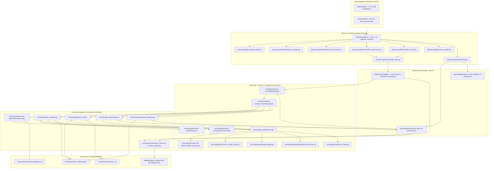

# TC PRIMED Phase 2D — Source Execution and Architecture Dependency Map

## 1. System Execution Architecture

The repository exhibits a decoupled, two-stage data-contract architecture:
1. **Stage 1 (Data Processing Engine)**: Ingests raw NOAA TC PRIMED NetCDF files, executes quality control, re-centers grids, matches environmental reanalysis, computes forecast targets, and writes HDF5 containers.
2. **Stage 2 (Spatiotemporal ML Engine)**: Loads HDF5 containers, collates multimodal batches, executes self-supervised pretraining, multi-task learning, fine-tuning, and baseline evaluation.

The communication contract between Stage 1 and Stage 2 is **filesystem-mediated** via standardized HDF5 containers and the unified metadata manifest `reports/pipeline/sample_index.csv`.

---

## 2. End-to-End Execution Flow Diagram

---

## 3. Component Coupling & Disconnected Code Analysis

### 3.1 Connected Core Pipeline
- **Production Preprocessing Path**:
  `tcprimed_pipeline/__main__.py` $\to$ `PipelineRunner.run_pipeline()` $\to$ `NetCDFReader` $\to$ `MetadataExtractor` $\to$ `EnvironmentalMatcher` $\to$ `ModalityProcessors` $\to$ `QualityControl` $\to$ `StorageWriter` $\to$ `HDF5 Containers`.
  *Status*: **Fully Connected & Tested** via `tests/test_pipeline_units.py` and `tests/test_pipeline_real_data.py`.
- **Production ML Path**:
  `reports/pipeline/sample_index.csv` + `data/processed/pilot/` $\to$ `TCPRIMEDDataset` $\to$ `collate_multimodal_batch` $\to$ `TCGraphFormer` (5 Encoders $\to$ 80-token Fusion $\to$ 16-node Graph $\to$ Causal Temporal $\to$ 6 Task Heads) $\to$ `MultiTaskLoss` $\to$ `TCGraphFormerTrainer` $\to$ `checkpoints/best_checkpoint.pt`.
  *Status*: **Fully Connected & Tested** via `tests/test_two_machine_pipeline.py`.

### 3.2 Exploratory Precursor Code (Disconnected from Production Pipeline)
The following modules in `src/` were developed during Phase 1 (historical exploratory investigation). They are not called by `tcprimed_pipeline` or the ML training engine:
1. `src/inspect_netcdf.py`: Phase 1A CLI utility for dumping NetCDF group hierarchies.
2. `src/validate_netcdf.py`: Phase 1A sanity check on GMI samples.
3. `src/prepare_pilot_dataset.py`: Phase 1B/1C S3 inventory parsing and downloader. (The production pipeline now has its own `tcprimed_pipeline/inventory.py`, though `src/prepare_pilot_dataset.py` remains useful as an S3 download script).
4. `src/audit_pilot_modalities.py`: Phase 1D modality coverage audit script.
5. `src/eda_pilot_dataset.py`: Phase 1E exploratory analysis and 12-figure generation script.
6. `src/reconcile_pilot_consistency.py`: Phase 1F reconciliation script.

*Recommendation*: Maintain these precursor scripts in `src/legacy/` or `src/tools/` for documentation and provenance, but do not consider them active components of the Phase 3 training system.

---

## 4. Execution Interfaces & CLI Entry Points

| Command / Entry Point | Configuration File | Inputs Consumed | Outputs Generated | Resume Behaviour | Side Effects |
| :--- | :--- | :--- | :--- | :--- | :--- |
| `python -m tcprimed_pipeline` | `configs/pilot.yaml` | `data/raw/pilot/` | `data/processed/pilot/`, `reports/pipeline/*` | Checks existing storm HDF5 files; skips completed storms if `--resume` passed | Creates output folders; logs processing statistics |
| `python src/training/pretrain.py` | `configs/pretraining.yaml` | `reports/pipeline/sample_index.csv`, `data/processed/` | `checkpoints/pretrained_backbone.pt`, `reports/pretraining_summary.json` | None (runs from epoch 1) | Writes model weights to disk |
| `python src/training/train_multitask.py` | `configs/multitask_training.yaml` | `sample_index.csv`, `data/processed/`, optional backbone ckpt | `checkpoints/best_checkpoint.pt`, `reports/training_framework_report.md` | Loads checkpoint if specified in `--resume-from` | Updates latest and best model checkpoints |
| `python src/training/finetune_task.py` | `configs/finetuning.yaml` | `checkpoints/best_checkpoint.pt`, `sample_index.csv` | `checkpoints/finetuned_*.pt`, `reports/finetuning_*_summary.json` | Requires base checkpoint; trains specified epochs | Freezes encoders; optimizes task heads |
| `python src/training/ri_experiments.py` | Hardcoded / CLI | `sample_index.csv`, `data/processed/` | `reports/phase2c/ri_class_imbalance_experiments.csv` | None (evaluates loss functions) | Computes validation curves |
| `python src/evaluation/evaluate_baselines.py`| Hardcoded / CLI | `checkpoints/best_checkpoint.pt`, `sample_index.csv` | `reports/phase2c/baseline_comparison.csv`, `task_metrics_by_horizon.csv` | None | Loads checkpoint; evaluates Val & Test |
| `python src/infrastructure/export_shards.py`| CLI arguments | `data/processed/pilot/`, `sample_index.csv` | `staging/staging_manifest.json` | Re-computes SHA-256 for all files | Generates transfer manifest |

