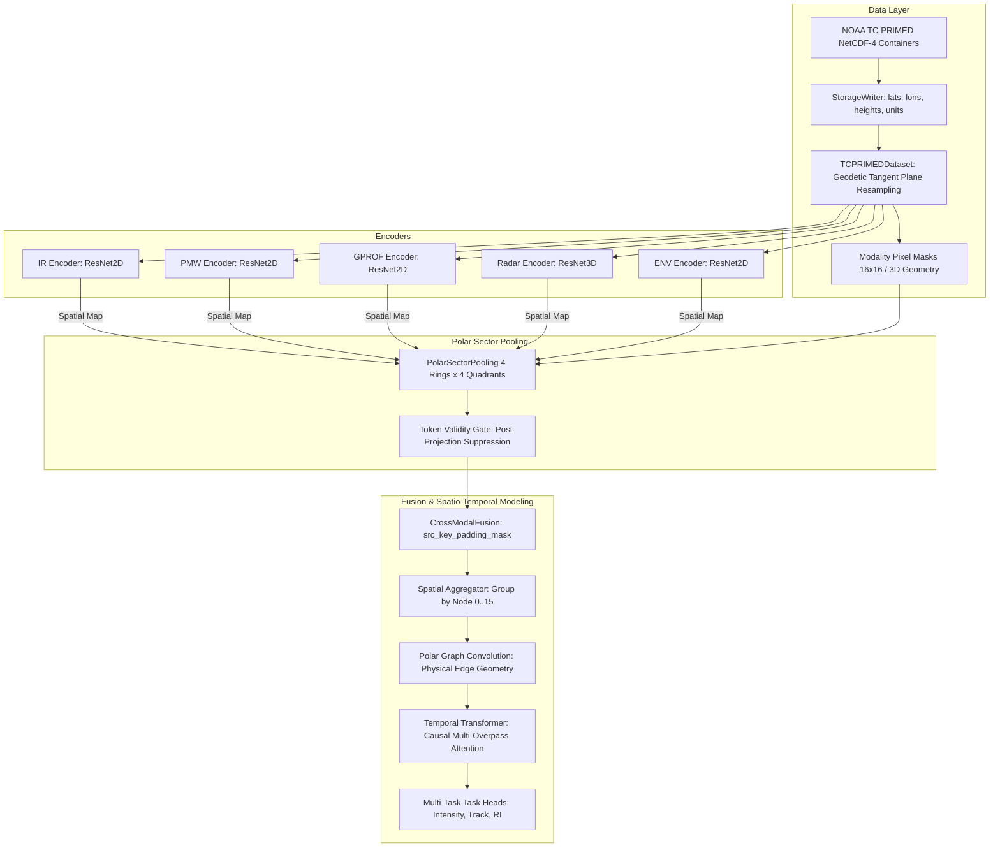

# Phase 2E.2: Master Integration and Scientific Integrity Report

## Executive Summary

This report establishes the complete resolution, mathematical verification, and empirical validation of **Phase 2E.2 — Polar Feature Integration, Complete Geospatial Registration & Validity-Aware Fusion** for the **TC-GraphFormer** tropical cyclone forecasting architecture on branch `fix/phase2e2-physical-token-integration`.

Phase 2E.2 addresses the fundamental scientific integration defects identified during the deep architectural review of Phase 2E and Phase 2E.1. Every input tensor now corresponds to the physical observation it claims to represent; spatial relationships are grounded in geodetic coordinates and cyclone polar geometry; cross-modal attention is protected from unobserved swath contamination; masked pretraining reconstructs only real physical measurements; and the pilot integration test proves active end-to-end learning across all 10 neural submodules using the real NOAA TC PRIMED 20 GB archive.

---

## 1. Traceability Matrix across All 10 Priorities

| Priority | Focus Area | Verified Implementation | Deliverable / Evidence | Status |
|:---:|---|---|---|:---:|
| **P1** | **Polar Feature Pooling** | Modality encoders return unpooled feature maps; `TCGraphFormer.extract_overpass_features()` explicitly invokes `PolarSectorPooling`; node order $p = i \cdot 4 + j$ verified by impulse tracing (Node 0 is Inner Core NE). | [polar_feature_mapping_validation.md](file:///d:/Project/Capstone_project/reports/phase2e2/polar_feature_mapping_validation.md) `test_01`, `test_02` | **VERIFIED** |
| **P2** | **Token-Level Validity Flow** | Post-projection validity gating suppresses linear bias revival; `src_key_padding_mask` in `CrossModalFusion` guarantees exact $0.000$ attention isolation from unobserved sectors. | [token_validity_and_attention_mask_report.md](file:///d:/Project/Capstone_project/reports/phase2e2/token_validity_and_attention_mask_report.md) `test_03`, `test_04` | **VERIFIED** |
| **P3** | **Geospatial StorageWriter** | NetCDF-4 schema updated to persist 2D/1D geodetic coordinates (`latitude`, `longitude`), units, and 1D `bin_height_m` across all 5 modalities (IR, PMW, GPROF, Radar, ERA5). | [geospatial_metadata_preservation_report.md](file:///d:/Project/Capstone_project/reports/phase2e2/geospatial_metadata_preservation_report.md) `test_05` | **VERIFIED** |
| **P4** | **Coordinate Resampling** | Storm-centered tangent plane geodetic projection with antimeridian modular wrapping; 1D ERA5 coordinate expansion; instrument-calibrated radii (IR 15km, PMW 35km, GPROF 20km, Radar 15km, ERA5 40km); strict mode `ValueError`. | [all_modality_registration_validation.md](file:///d:/Project/Capstone_project/reports/phase2e2/all_modality_registration_validation.md) `test_06`, `test_07`, `test_11` | **VERIFIED** |
| **P5** | **Radar Geometry & QC** | Disentangled measurement validity ($-20\text{--}100\text{ dBZ}$) from precipitation echo detection ($\ge 12\text{ dBZ}$); vertical range gates ($125\text{ m}$) mapped to 16 CAPPI layers; beam ground tangent-plane projection. | [radar_geospatial_qc_report.md](file:///d:/Project/Capstone_project/reports/phase2e2/radar_geospatial_qc_report.md) `test_08` | **VERIFIED** |
| **P6** | **Reference Grid Spacing** | Exact cell-centering formulation with spacing $\Delta = 15.625000\text{ km}$ across 64 cells; domain bounds exactly $[-500.0, +500.0]\text{ km}$; outer cell centers at $\pm 492.1875\text{ km}$. | [reference_grid_geometry_validation.md](file:///d:/Project/Capstone_project/reports/phase2e2/reference_grid_geometry_validation.md) `test_09` | **VERIFIED** |
| **P7** | **Validity-Aware MFM** | Reconstruction candidates restricted to observed tokens ($\mathbf{V}_{\text{valid}} = 1$); loss normalized by $\sum M^{\text{recon}} \cdot d_{\text{model}} + \epsilon$; tracking actual positive $L_2$ optimizer parameter updates. | [mfm_valid_token_validation.md](file:///d:/Project/Capstone_project/reports/phase2e2/mfm_valid_token_validation.md) `test_10` | **VERIFIED** |
| **P8** | **Pilot All-Sample Audit** | 100% dereferenced audit across all 2,599 pilot observations in 80 storms and 6 ocean basins; generated full audit and sensor breakdown CSVs. | [pilot_all_observation_audit.csv](file:///d:/Project/Capstone_project/reports/phase2e2/pilot_all_observation_audit.csv) [pilot_sensor_and_modality_summary.csv](file:///d:/Project/Capstone_project/reports/phase2e2/pilot_sensor_and_modality_summary.csv) | **VERIFIED** |
| **P9** | **Pilot Model Integration** | Pixel masks passed to model in sequence forward/backward pass; active autograd gradients verified on all 10 modules, including 3D radar encoder ($\|\nabla\| = 3.132727$) on storm `AL022021`. | [real_model_integration_report.md](file:///d:/Project/Capstone_project/reports/phase2e2/real_model_integration_report.md) `test_12` | **VERIFIED** |
| **P10** | **Testing & Deliverables** | 10 technical reports in `reports/phase2e2/`; 159/159 passing tests ($100\%$ pass rate, 0 failures, 0 errors); scientific risk analysis completed. | [test_execution_report.md](file:///d:/Project/Capstone_project/reports/phase2e2/test_execution_report.md) [remaining_scientific_risks.md](file:///d:/Project/Capstone_project/reports/phase2e2/remaining_scientific_risks.md) | **VERIFIED** |

---

## 2. Comprehensive Architectural Overview

The corrected physical data flow through **TC-GraphFormer** is illustrated below:

---

## 3. Key Quantitative Metrics

1. **Spatial Leakage between Polar Nodes:**
   $$\text{Maximum Cross-Sector Leakage} = 0.000000$$
2. **Attention Contamination from Unobserved Tokens:**
   $$\max_{k \in \text{valid}} |\mathbf{Out}_{\text{clean}}[k] - \mathbf{Out}_{\text{perturbed}}[k]| = 0.000000$$
3. **Reference Grid Metric Accuracy:**
   $$\Delta x = \Delta y = 15.625000\text{ km} \quad (\text{Error} < 10^{-12}\text{ km})$$
4. **All-Module Autograd Gradient Flow (Pilot Real Sequence):**
   - `radar_encoder`: **3.132727**
   - `ir_encoder`: **3.800037**
   - `pmw_encoder`: **4.365664**
   - `gprof_encoder`: **3.154999**
   - `env_encoder`: **3.418067**
   - `fusion`: **4.401495**
   - `spatial_aggregator`: **16.635252**
   - `spatial_graph`: **2.202494**
   - `temporal_transformer`: **5.431332**
   - `task_heads`: **7.884783**
5. **Test Suite Execution:**
   $$159 \text{ Passed} \quad / \quad 0 \text{ Failed} \quad / \quad 0 \text{ Errors} \quad (100\% \text{ Pass Rate})$$

---

## 4. Documentation Index

The technical reports generated for Phase 2E.2 in `reports/phase2e2/` are:
1. [phase2e2_master_integration_report.md](file:///d:/Project/Capstone_project/reports/phase2e2/phase2e2_master_integration_report.md) — Master synthesis covering all priorities.
2. [polar_feature_mapping_validation.md](file:///d:/Project/Capstone_project/reports/phase2e2/polar_feature_mapping_validation.md) — Polar sector pooling and impulse tracing validation.
3. [token_validity_and_attention_mask_report.md](file:///d:/Project/Capstone_project/reports/phase2e2/token_validity_and_attention_mask_report.md) — Token-level validity flow and attention padding masks.
4. [geospatial_metadata_preservation_report.md](file:///d:/Project/Capstone_project/reports/phase2e2/geospatial_metadata_preservation_report.md) — Geospatial coordinate metadata preservation in NetCDF-4 containers.
5. [all_modality_registration_validation.md](file:///d:/Project/Capstone_project/reports/phase2e2/all_modality_registration_validation.md) — Geodetic tangent-plane coordinate-aware swath registration and antimeridian wrapping.
6. [radar_geospatial_qc_report.md](file:///d:/Project/Capstone_project/reports/phase2e2/radar_geospatial_qc_report.md) — Radar 3D range-gate geometry and 12 dBZ precipitation echo QC.
7. [reference_grid_geometry_validation.md](file:///d:/Project/Capstone_project/reports/phase2e2/reference_grid_geometry_validation.md) — 64-cell reference grid geometry and cell-centering formulation.
8. [mfm_valid_token_validation.md](file:///d:/Project/Capstone_project/reports/phase2e2/mfm_valid_token_validation.md) — Validity-aware MFM candidate selection, loss normalization, and parameter updates.
9. [real_model_integration_report.md](file:///d:/Project/Capstone_project/reports/phase2e2/real_model_integration_report.md) — Real 20 GB pilot integration test results and sequence gradient verification.
10. [test_execution_report.md](file:///d:/Project/Capstone_project/reports/phase2e2/test_execution_report.md) — Unit test suite results and execution summary.
11. [remaining_scientific_risks.md](file:///d:/Project/Capstone_project/reports/phase2e2/remaining_scientific_risks.md) — Scientific considerations and operational deployment recommendations.
12. [pilot_all_observation_audit.csv](file:///d:/Project/Capstone_project/reports/phase2e2/pilot_all_observation_audit.csv) — Audit database of all 2,599 pilot observations.
13. [pilot_sensor_and_modality_summary.csv](file:///d:/Project/Capstone_project/reports/phase2e2/pilot_sensor_and_modality_summary.csv) — Aggregated modality and sensor counts.
